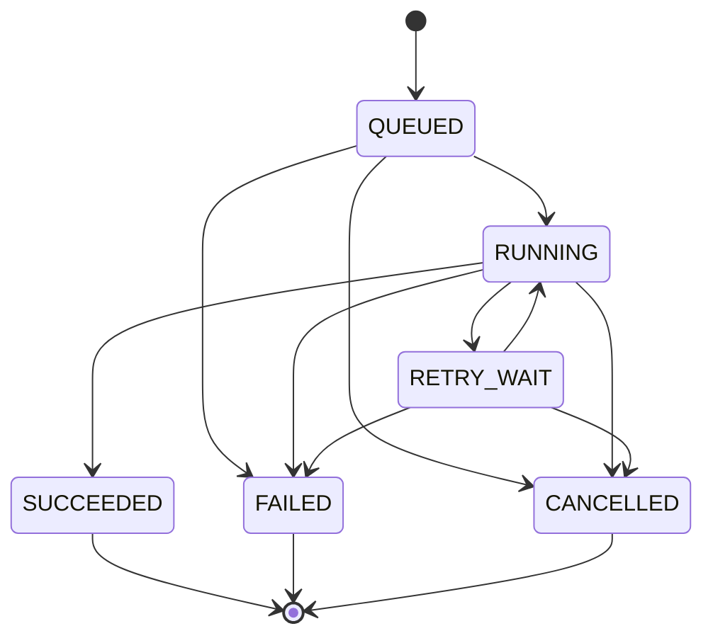

# 2026 年工程实践总结

工程问题经常出现在边界上：请求成功但数据未更新，模型返回但结果不完整，页面正常但重启后失效，文件看似遮挡却仍有其他副本。可靠的实现需要把输入契约、状态转换、持久化结果、界面反馈和失败恢复连成一条可检查的链。

以下围绕十五个主题展开设计与排查方法，适用于涉及前后端协作、异步任务、文档处理和 AI 能力的应用。文中的任务、数据、配置与计算示例均为模拟场景；验证表描述预期行为，供实现和验收使用。

## 阅读导航

| 方向 | 主题 |
| --- | --- |
| 需求与数据正确性 | [需求验收](#一-把需求转为可验收约束)、[操作闭环](#二-把删除撤销与恢复纳入操作闭环)、[保存链路](#三-沿完整链路确认数据是否真正更新)、[证据判断](#四-用证据质量约束自动判断) |
| 后台与 AI 流程 | [异步状态](#五-明确-ai-异步流程的完成条件)、[文件隐私](#六-按文件生命周期设计-pdf-隐私处理)、[离线部署](#七-从运行时证据确认离线部署生效)、[批量边界](#八-让批量操作拒绝歧义) |
| 交付质量 | [AI 成本](#九-按合格交付量核算-ai-成本)、[操作手册](#十-把操作手册作为可验证的交付物) |
| 专项排查与表达 | [数据库异常](#十一-沿异常链区分数据库失败阶段)、[邮件解析](#十二-用独立邮件快照支持解析与补偿)、[分页](#十三-同时处理分页的渲染状态与数据边界)、[移动端](#十四-从公共控件统一移动端行为)、[知识表达](#十五-把知识写成可以独立使用的答案) |

## 一 把需求转为可验收约束

### 将体验目标与硬约束分开

“更简洁”“更自然”“操作方便”能表达方向，却不能直接确定改动范围。以界面底栏为例，隐藏整个栏、隐藏背景、降低背景透明度、保留图标但缩小占位，是不同需求。

需求应同时描述目标、保留条件、适用环境和判断方式。下面是模拟的底栏定制需求：

| 维度 | 明确约定 |
| --- | --- |
| 目标 | 降低底栏背景的视觉存在感 |
| 保留条件 | 图标、点击区域、键盘操作和原有入口保持可用 |
| 持久化 | 刷新和重启后读取同一份有效配置 |
| 恢复能力 | 可以恢复默认值，不需要手工删除文件 |
| 验收方式 | 对比背景、执行图标操作、重新进入页面、重启后复查 |

### 将条件写成状态变化

使用“前置状态、触发操作、可观察结果”的结构，把主观目标落到具体行为。例如：默认背景可见时将透明度设为零，应只改变背景；存在自定义设置时执行恢复默认，应同时更新持久化值和当前界面。

必须区分显示效果与功能状态。元素不可见后是否仍占位、能否获取焦点、是否拦截点击，都属于独立检查项。图标仍然可见也不代表其点击范围、快捷键和辅助技术语义仍然正确。

验收至少覆盖默认值、边界值、非法配置、刷新、重启、恢复默认和不同屏幕尺寸。不能只用一张对比图替代行为验证。

## 二 把删除撤销与恢复纳入操作闭环

### 为正向操作配置对应的退出路径

上传后无法删除、编辑后无法撤销、替换后无法判断旧资源是否保留，都会让局部可用的功能难以持续使用。

| 正向操作 | 配套能力 | 核心约束 |
| --- | --- | --- |
| 创建或上传 | 删除、替换、查看处理状态 | 区分上传完成与后续处理完成 |
| 编辑 | 取消、保存、冲突提示 | 取消不应产生部分写入 |
| 配置定制 | 恢复默认、版本迁移 | 恢复后内存状态与持久化状态一致 |
| 长时间处理 | 取消、超时提示、重试 | 取消后迟到结果不能重新激活旧任务 |
| 批量修改 | 预览、排除、结果清单、补偿 | 明确成功范围和失败范围 |

### 区分撤销回滚与补偿

撤销面向使用者，尝试恢复上一步操作前的状态；事务回滚面向未提交事务；补偿用于处理已经发生且不能简单回滚的外部效果。邮件已经发出、对象已经上传之后，数据库回滚不会自动撤回这些动作。

跨存储操作可以拆成“准备资源、验证资源、切换引用、清理旧资源”。每一步记录结果，失败后从确定的位置继续，避免直接重放整条流程。保留旧版本时，还应明确访问权限和保留期限，不能为了恢复方便无限保存敏感副本。

验证重点是中途失败：上传完成但保存引用失败、保存成功但响应丢失、清理失败、重复点击、取消后回调到达。最终结果应能被重新查询，不依赖一次页面提示来判断。

## 三 沿完整链路确认数据是否真正更新

### 在输入边界统一类型和语义

相同 JSON 结构经过不同序列化工具后，可能落成普通集合、映射或某个库的专用节点类型。业务代码若只接受一种具体运行时类型，其他合法输入可能被跳过。应用入口应统一为明确的 DTO、集合或树模型，再交给合并逻辑处理。

更新接口还必须明确缺失、空值和空集合的含义：

| 输入形态 | 需要定义的契约 |
| --- | --- |
| 不携带字段 | 保持原值，还是判定请求缺少必填项 |
| 显式 `null` | 清空、删除成员、设为空值，还是拒绝 |
| 空数组 `[]` | 清空集合，还是业务上不允许 |
| 非空数组 | 整体替换，还是按稳定标识合并 |
| 字段类型错误 | 明确拒绝并定位字段，避免静默忽略 |

具体语义取决于更新协议。采用 `application/merge-patch+json` 的 JSON Merge Patch 时，缺失成员保持不变，`null` 表示删除成员，数组整体替换；这些规则不能直接套用到普通 POST、完整资源替换或自定义更新接口。删除 JSON 成员如何映射到存储，也需要应用单独定义。[RFC 7396](https://www.rfc-editor.org/rfc/rfc7396.html)

需要区分“未提交”与“提交空值”的更新 DTO，应显式保留字段存在性，不能在解析后把两者都折叠为同一个默认空值。

### 按六个观测点定位问题

```text
编辑器状态 → 请求载荷 → 解析后的值与类型 → 合并后的结果 → 持久化结果 → 重新查询后的展示
```

在每个观测点检查相同的模拟对象与版本，避免把不同请求的日志拼成一条链。日志记录字段名、类型、集合长度、版本和错误位置，敏感字段不打印原值。

写入成功后，前端可读取服务端返回的规范化结果，或重新查询一次确定的版本。若使用缓存、乐观更新或异步投影，需要约定“何时可见”，并区分写入失败、读取滞后和旧请求覆盖新状态。

验证矩阵应包括缺失字段、`null`、空数组、类型错误、嵌套对象、重复提交、版本冲突和服务端归一化。并发编辑可通过版本条件更新识别冲突，不能让后到的旧数据覆盖新结果。

## 四 用证据质量约束自动判断

### 分清不同的编号体系

PDF 的物理页序、阅读器页标签、印刷页码和章节编号不是同一个概念。封面没有印刷页码、正文重新编号、附录使用另一套编号，都可能是合法结构。阅读器的页标签也可能采用罗马数字。[pypdf 页与页标签接口](https://pypdf.readthedocs.io/en/stable/modules/PdfReader.html)

未重复表头、没有“续下页”提示、同号标题不同，可以触发查看上下文，不能只凭描述数量直接判定缺页。章节编号跳跃也应结合模板允许的编号规则、材料类型和前后内容判断。

### 保存能够核对的证据结构

一条证据应包含定位、观察事实、支持的假设、替代解释和反证条件。模拟记录可以写成：物理第 4 页顶部没有表头，但首行能够承接上一页末行；支持“表格跨页”，不支持“已发生缺页”。

多条描述如果来自同一张模糊图片或同一个 OCR 错误，就不能被当成相互独立的证据。没有经过标注样本校准时，不使用“疑点数量达到某值即等于某置信度”的规则。

输出可以区分“发现可定位的结构异常”“存在疑点需要复核”“没有发现异常”。最后一类表示检查未命中，不等于完整性保证。

验证材料应覆盖完整文档、真实删除页、重复页、续表、正文重新编号、附录编号、模糊扫描和内容截断。分别统计误报与漏报，并按文档类型归因，避免整体准确率掩盖高风险子类。

## 五 明确 AI 异步流程的完成条件

### 分开执行状态与结果完整性

HTTP `202 Accepted` 表示请求已接收但尚未完成处理，不能据此提示“识别成功”。客户端需要能查询任务状态和结果。[RFC 9110 的 202 语义](https://www.rfc-editor.org/rfc/rfc9110.html#name-202-accepted)

一种可采用的任务状态设计如下，结果是否完整作为独立属性记录：



只有满足约定的必需阶段、内容检查和持久化条件，才能进入 `SUCCEEDED`。部分候选结果可在执行中展示；最终无法补齐必需内容时，应给出明确的失败状态与可查看结果。可选阶段失败则按契约显示警告，不能与必需阶段混用。

### 给重试与回调明确身份

任务至少携带任务标识、执行轮次、输入版本、处理配置版本和结果版本。回调先检查任务是否仍有效，再以条件更新方式写入结果。重复回调返回等价结果，旧轮次、已取消任务和较旧结果版本不能覆盖当前状态。

幂等记录与本地业务结果应在同一事务中提交。涉及外部存储或通知时，可使用可靠事件记录再投递；任务超时后先查询前次执行情况，再决定是否重试。同一幂等键收到不同参数时应拒绝混用。[AWS 幂等重试设计](https://aws.amazon.com/builders-library/making-retries-safe-with-idempotent-APIs/)

后台通过租约或心跳识别执行失联与租约过期，再按总截止时间恢复或结束任务。心跳超时也可能来自网络分区或进程暂停，恢复时以新的执行轮次和条件写入隔离旧执行。页面重新打开不应自动创建新任务，而应恢复查询服务端状态。

`CANCELLED` 表示本地不再接受该执行的结果；已经发出的远端计算是否停止、是否继续计费，取决于远端取消能力，不能仅凭本地终态推定。

### 按层检查输出

| 检查层 | 需要确认的内容 | 失败处理 |
| --- | --- | --- |
| 传输 | 是否超时、连接中断或服务错误 | 分类记录，可重试错误受预算约束 |
| 生成 | 是否截断、拒绝、空正文 | 不将空结果写成成功 |
| 结构 | 是否可解析，字段类型是否符合契约 | 返回结构化错误位置 |
| 完整性 | 必需模块、条目和依赖是否齐备 | 保留部分结果与缺项说明 |
| 领域约束 | 取值范围、引用和跨字段关系是否成立 | 转人工复核或明确失败 |
| 提交 | 是否成功持久化且可查询 | 通过幂等提交和补偿处理 |

JSON Schema 中，仅声明 `properties` 不会要求字段必填，必填项需放入 `required`；数组是否允许为空由契约决定，必要时设置 `minItems`。结构合法仍不代表事实正确。[对象约束](https://json-schema.org/understanding-json-schema/reference/object)、[数组约束](https://json-schema.org/understanding-json-schema/reference/array)

验证场景包括重复或乱序回调、取消后回调、任务执行完但消费失败、截断输出、部分模块缺失、进程重启和重试耗尽。重试同时限制次数、总截止时间和并发，采用退避与抖动，避免故障恢复时集中重复请求。[重试与抖动机制](https://docs.aws.amazon.com/step-functions/latest/dg/concepts-error-handling.html)

## 六 按文件生命周期设计 PDF 隐私处理

### 区分视觉覆盖与内容移除

在页面上画黑框、添加覆盖层或裁剪可见区域，都不足以证明底层内容已经删除。裁剪可能仅改变可见区域，原有内容仍保留在文件中。[pypdf 裁剪说明](https://pypdf.readthedocs.io/en/stable/user/cropping-and-transforming.html)

真正的区域删改应使用能移除对应内容的处理过程。以 PyMuPDF 为例，创建删改批注与应用删改是两个阶段；文字、图片、矢量图形的处理选项需要按所用版本确认。[PyMuPDF 区域删改](https://pymupdf.readthedocs.io/en/latest/page.html#Page.apply_redactions)

### 明确处理对象与坐标体系

前端选择框要记录页标识、页面尺寸、旋转、裁剪区域和坐标约定，再转换到服务端页面坐标。缩放比例变化、设备像素比和旋转页面都应有独立验证场景；不能把屏幕像素直接作为文件坐标。

页内容之外，还应盘点 OCR 文字、批注、表单、附件、嵌入文件、元数据和预览副本。应用区域删改之后采用适当的完整保存与对象清理，不把增量保存当成旧内容清除。文档清理接口也应按具体选项核对作用范围。[PyMuPDF 文档清理](https://pymupdf.readthedocs.io/en/latest/document.html#Document.scrub)

### 用受控切换发布新文件

```text
生成新对象 → 重新打开并验证 → 事务切换引用并登记清理 → 按保留策略异步清理
```

新对象生成或验证失败时保留当前有效引用。引用切换与待清理记录在同一本地事务中提交，或通过可恢复的可靠事件连接，避免切换后崩溃导致旧对象永远无人清理；对没有完成引用切换的新对象也要有过期回收机制。

清理前检查共享引用，避免删除其他记录仍在使用的资源。保留策略同时考虑恢复与隐私，原件、衍生物和备份分别设置权限与生命周期。

对象存储启用版本控制时，普通删除可能只增加删除标记，旧版本仍然存在。指定版本删除也不等于其他版本、备份和独立副本全部消失。[S3 对象删除语义](https://docs.aws.amazon.com/AmazonS3/latest/API/API_DeleteObject.html)

导出后至少检查渲染、复制、搜索、文字与图片提取、附件、元数据和访问权限。将“处理范围内的内容已移除”和“所有副本已清理”作为不同验收项；只对明确验证过的范围作结论。

## 七 从运行时证据确认离线部署生效

### 将应用与模型作为一组制品交付

离线部署需要一份能核对的制品清单：应用版本、镜像摘要、模型文件校验值、运行依赖、处理器架构、CPU 或 GPU 条件、加载入口和预期目录结构。文件已经上传不等于进程能够加载。

镜像标签可以重新指向不同内容，镜像摘要可用于固定具体镜像。交付记录可同时保留可读版本和摘要，减少“名称相同却运行不同内容”的歧义。[Docker 镜像摘要](https://docs.docker.com/reference/cli/docker/image/pull/#pull-an-image-by-digest-immutable-identifier)

### 沿运行链逐项确认

| 层次 | 检查内容 |
| --- | --- |
| 实际镜像 | 运行实例使用的摘要是否对应目标制品 |
| 进程配置 | 必要变量是否存在，敏感值仅记录校验结果 |
| 挂载 | 路径、权限、只读属性和目标文件是否正确 |
| 文件 | 校验值、文件名和模型所需文件是否齐备 |
| 加载 | 进程最终选择的入口与模型目录是否符合预期 |
| 推理 | 在隔离环境完成最小模拟输入到输出的检查 |

`docker compose restart` 不会应用 Compose 文件中的新环境变量等配置；`up` 可根据配置或镜像变化重建容器。`--force-recreate` 负责重建容器，不替代构建或拉取新镜像。[restart](https://docs.docker.com/reference/cli/docker/compose/restart/)、[up](https://docs.docker.com/reference/cli/docker/compose/up/)

挂载目录可能遮住镜像中原有文件。模型目录可以只读挂载，运行缓存另设可写位置，并按容器实际用户检查权限。[Docker bind mounts](https://docs.docker.com/engine/storage/bind-mounts/)

完全离线场景应禁止隐式下载回退。可以在无网络隔离容器中检查加载与最小推理，并单独检查服务启动、请求处理和重启路径是否仍依赖外网。[Docker none 网络](https://docs.docker.com/engine/network/drivers/none/)

## 八 让批量操作拒绝歧义

### 先定义候选集合再执行修改

两个表格都有“名称”列，并不代表它们属于同一字段。批量匹配应依赖稳定的结构身份、行身份和字段身份，不能仅靠显示名、旧值或会产生碰撞的标准化名称。

预览阶段给出匹配、可修改、冲突和跳过数量。存在多个合理目标时拒绝自动选择；权限不足、已删除、版本变化或不满足前置条件的对象，都应说明跳过原因。

### 将预览与执行连接起来

预览结果只是某一时刻的快照。执行时重新检查权限和版本，并绑定操作标识、输入摘要和选择范围。重复提交同一操作应取得相同结果，而不是再次修改已经改变的值。

明确采用全有或全无，还是允许部分成功。允许部分成功时，为每个目标记录结果和可重试范围；全有或全无时，需要在事务可覆盖的边界内执行，外部效果另行补偿。

| 验证场景 | 预期行为 |
| --- | --- |
| 同名字段位于不同结构 | 不跨结构误改 |
| 预览后另一人更新对象 | 检测版本冲突 |
| 部分对象无权限或已删除 | 按约定拒绝或跳过，并给原因 |
| 重复提交或响应丢失后重试 | 不重复应用操作 |
| 多行写入数组或对象 | 不因共享可变引用而互相影响 |
| 数据量超出同步处理能力 | 分批或转任务，并保留可查询进度 |

批次大小同时受事务时长、锁竞争、内存和接口超时约束。大批量处理宜使用稳定游标或明确的目标标识清单，避免分页偏移随修改变化而漏处理。

## 九 按合格交付量核算 AI 成本

### 明确分母与成本范围

一次模型调用、一份候选结果和一份通过验收的交付物，是不同计量单位。比较方案前先固定质量要求，再决定分母是任务、页面、镜头还是结构化结果。

```text
单位合格交付成本
=（模型费用 + 计算与存储费用 + 人工复核与修正成本）/ 合格交付量

首次通过率 = 首次尝试即通过验收的任务数 / 发起任务总数
```

合格交付量为零时不计算有限的单位成本；同时报告投入和失败原因。人工时长、交付周期与服务费用分别记录，避免把机器等待时间直接当成人工工时。

### 同时衡量质量速度与返工

建议保留输入与配置版本、尝试次数、采用比例、人工修正时间、端到端耗时、失败阶段和最终质量等级。对比时固定模拟样本与验收规则，按样本类型分组，避免简单任务比例变化造成假提升。

重试前先查询前一次是否已完成。请求超时可能发生在远端处理之后，直接重发可能产生重复计算和重复写入。对同一输入复用中间结果时，缓存键至少包含输入摘要、处理器版本和配置摘要；权限范围与保留策略也必须进入设计。[幂等请求与重试](https://aws.amazon.com/builders-library/making-retries-safe-with-idempotent-APIs/)

预算需要同时约束尝试次数、费用、截止时间与并发。无法自动补齐的结果交给人工处理或明确失败，避免在同一输入上无限修复。

## 十 把操作手册作为可验证的交付物

### 从真实功能到模拟操作路径

手册应对应明确的应用版本、角色权限和界面状态。先确认入口与行为，再在隔离演示环境中构造模拟数据，最后生成截图和步骤说明，避免旧图与新流程拼接。

每个操作场景至少写明入口、前置条件、输入、操作、成功标志、失败提示和恢复方式。实现类名、内部接口与敏感日志放入维护资料，不混进面向使用者的操作步骤。

### 建立功能与文档之间的追溯关系

| 文档元素 | 应能对应的验证对象 |
| --- | --- |
| 页面名称和入口 | 当前导航、角色可见性和直接访问权限 |
| 操作步骤 | 可重复执行的模拟场景 |
| 截图 | 相同版本、相同状态和完全模拟数据 |
| 结果说明 | 页面、任务或文件的可观察结果 |
| 异常说明 | 空数据、权限不足、失败和恢复路径 |

功能变化时检查受影响场景，而不是机械重拍所有截图。可编辑源文件与阅读版保持一致，检查目录跳转、链接、代码块、表格跨页、截图可读性和窄屏阅读。

当某项功能需要大量文字才能解释入口、状态或下一步操作时，应回看界面是否存在可改进的表达。手册可帮助发现产品理解成本，但不应替代必要的界面反馈。

## 十一 沿异常链区分数据库失败阶段

### 顶层异常用于定位入口底层原因用于缩小范围

“连接异常”可能出现在等待连接池、建立连接、执行查询或读取响应阶段。最内层原因能提供线索，但还需结合耗时、调用栈和失败阶段，不把某个异常名称当作唯一根因。

| 阶段 | 典型观察 | 优先核对 |
| --- | --- | --- |
| 连接池等待 | 活跃连接占满，获取连接超时 | 池占用、长事务、泄漏和排队请求 |
| 建立连接 | 连接未建立即失败 | 地址解析、网络可达性、握手与认证 |
| 查询执行 | 查询长时间运行或等待锁 | 执行计划、扫描量、锁等待和事务 |
| 响应读取 | 已发起查询，等待响应时超时 | 查询进度、链路中断和驱动读取限制 |
| 结果处理 | 服务端返回后客户端仍缓慢 | 结果规模、反序列化、流式读取和应用处理 |

### 不同超时参数约束不同阶段

连接池等待时间、驱动建连时间、网络读取时间和语句执行时间不能互相替代。例如，HikariCP 的 `connectionTimeout` 约束等待池中连接，Connector/J 的 `connectTimeout` 约束建连，`socketTimeout` 约束网络 socket 操作。参数默认值与具体驱动、连接池和版本有关，应显式记录有效配置。[HikariCP 配置](https://github.com/brettwooldridge/HikariCP#configuration-knobs-baby)、[Connector/J 网络属性](https://dev.mysql.com/doc/connector-j/en/connector-j-connp-props-networking.html)

总请求预算还要覆盖排队、查询、结果处理和有界重试。上层超时或客户端断开，不一定意味着数据库语句已经停止；超时处理应检查取消、事务状态和资源释放。

### 先优化工作量再调整容忍时间

收集查询标识、参数形状、时间范围、连接池等待、查询耗时、返回规模和锁等待。日志对参数脱敏，避免为排障输出真实数据。

使用执行计划分析索引选择、估算行数和连接顺序。MySQL 的 `EXPLAIN ANALYZE` 会实际执行语句，因此使用前应评估查询成本，不能把它当成纯静态查看。月度累计查询要分别检查月初与月末的数据范围，不能用小样本速度代表最大查询范围。[MySQL 8.4 执行计划说明](https://dev.mysql.com/doc/refman/8.4/en/explain.html)

验证至少覆盖池耗尽、连接不可达、锁等待、慢查询、大结果集和客户端超时。每个场景应能定位到对应阶段，并确认失败后连接与事务得到妥善处理。

## 十二 用独立邮件快照支持解析与补偿

### 远端对象不是可无限延后读取的本地文件

IMAP 邮件对象可能在访问正文或附件时才读取远端数据。文件夹关闭后，原有邮件对象不能继续当作有效对象使用；重新打开文件夹也应重新获取对象。消息移除或连接失效同样需要处理。流程应在有效会话内取得所需内容，再以独立 MIME 快照交给后续解析。[Jakarta Mail Folder 生命周期](https://jakartaee.github.io/mail-api/docs/api/jakarta.mail/jakarta/mail/Folder.html)

快照下载使用临时对象，完成写入与完整性检查后再标记可解析；流和远端资源按约定释放。大邮件限制内存占用、总字节数、附件数量、嵌套深度和处理时间，不能为了独立快照把所有内容一次性读进内存。

### 以完成状态管理去重

```text
DISCOVERED → DOWNLOADING → SNAPSHOT_READY → PARSING → PERSISTING → COMPLETE

下载失败：记录失败阶段，再次进入 DOWNLOADING
解析失败：复用已校验快照，再次进入 PARSING
提交失败：查询已提交结果，以同一处理身份幂等重试
```

各阶段的重试应回到对应阶段，不统一从头执行。只有完成预期正文与附件处理并提交结果，才进入 `COMPLETE`。发现空正文时先判断是否为合法的仅附件邮件、MIME 分支选择错误或读取失败，不能把“空”自动当作失败或成功。

幂等身份应考虑来源账号、邮箱身份、UIDVALIDITY 和 UID；邮件的顺序号会变化，UID 也不是跨邮箱全局唯一。UIDVALIDITY 变化时按新命名空间重建映射，不继续使用旧游标。内容摘要可以辅助校验，但不能在未明确业务规则时把相同内容的不同邮件直接合并。[RFC 9051 的邮件身份语义](https://www.rfc-editor.org/rfc/rfc9051.html#section-2.3.1.1)

记录已发现邮件不等于解析完成。再次扫描命中相同身份时，应根据状态决定跳过、继续下载、重新解析或人工处理，而不是一律去重拦截。任务增加解析器版本时，要明确是复用快照重新解析，还是产生新的处理版本。

### 让不完整结果可见且可修复

记录失败阶段、尝试次数、输入快照摘要和处理器版本，不输出真实收件人、正文与附件内容。持久化结果与完成标识保持一致；正文失败但元数据入库时，不写成全流程成功。

模拟验收材料覆盖纯文本、HTML、仅附件、多层 MIME、内联图片、非标准文件名、下载中断、解析失败及重复投递。验证重试能够继续处理未完成邮件，且不会重复创建已经提交的结果。

## 十三 同时处理分页的渲染状态与数据边界

### 分开视图故障与查询故障

点击分页后出现渲染异常，可能涉及浮层、组件销毁、条件渲染或不稳定的键；数据显示异常则可能来自页码、总数、过滤条件或请求时序。先确认属于哪一条链，再检查相关状态，不把全部问题归到接口或组件库。

在最小可复现场景中检查浮层何时关闭、父节点何时卸载、加载态是否替换组件以及列表键是否稳定。临时关闭交互只能作为隔离问题的方法，不等于已经确认根因。

### 统一查询状态并拒绝过期响应

页码、每页条数、筛选、排序和请求序号应作为一组查询状态。筛选或页大小变化时按约定重置页码，避免多个侦听器分别触发重复请求。

新请求开始时可以取消旧请求，并为每次请求分配单调递增序号。只有最新请求才能提交数据、错误和加载状态；旧请求的 `finally` 也不能关闭新请求的加载提示。取消本地等待不代表服务端一定停止处理，因此响应身份检查仍然必要。

实现时清理组件或侦听器的异步副作用，并按所用版本选择生命周期 API。Vue 的清理机制和 `AbortController` 可以分别提供状态变化清理与请求取消能力。[Vue 侦听器清理](https://vuejs.org/guide/essentials/watchers#side-effect-cleanup)、[MDN AbortController](https://developer.mozilla.org/en-US/docs/Web/API/AbortController)

### 为总数变化定义有界恢复

下面的计算适用于一基页码、已知的非负总数和正整数 `pageSize`。总数未知时使用“是否还有下一页”等契约，不用零代替未知值。

```text
总页数 = ceil(total / pageSize)
可用最大页码 = max(1, 总页数)
```

当总数为零时显示空状态并保留逻辑页码 1；总数大于零但当前页超界时，可回退到最后有效页再查询一次。恢复应限制次数，若数据持续变化则提示刷新或使用稳定快照，避免递归请求。

查询使用确定排序，并在需要时加入唯一键打破相同排序值。高频变化的数据无法只靠偏移分页保证遍历稳定性，可以按场景采用游标或快照；筛选、总数与结果应尽量来自一致的查询口径。

| 场景 | 预期行为 |
| --- | --- |
| 空结果 | 总数为零，展示明确空状态 |
| 删除末页最后一条 | 有界回退，不停留在无效页 |
| 快速切换筛选或页码 | 旧结果不覆盖新查询 |
| 请求失败 | 保留可理解的状态和重试入口 |
| 组件销毁 | 清理相关请求与浮层，不提交已失效状态 |
| 低速网络与连续点击 | 无重复加载闪烁，无无限纠正请求 |

## 十四 从公共控件统一移动端行为

### 统一交互契约而不只统一外观

同类页面分别使用原生日期输入、自定义选择器和不同弹窗时，差异会扩展到值格式、可选范围、清空行为、焦点与错误提示。公共控件应统一输入输出与可访问性，具体实现再根据平台能力选择。

原生日期选择器的外观取决于操作系统和浏览器。共享组件能统一业务契约，但不能据此保证所有平台的原生弹窗外观相同。[MDN 日期输入](https://developer.mozilla.org/en-US/docs/Web/HTML/Reference/Elements/input/date)

日期型值与时间点要分开建模。仅表示日历日期的值不应被无意按 UTC 时间点转换；带时间的值要明确时区、序列化格式和展示规则。控件还应统一最小最大值、禁用态、键盘操作、关闭行为和焦点恢复。

### 让视口与安全区各自承担职责

动态视口高度用于适应浏览器界面变化，安全区用于避免内容被设备边缘或系统区域遮挡。`dvh` 会随浏览器界面变化，可能带来滚动时的尺寸变化，需按页面目标选择；它也不是通用的软键盘避让方案。[MDN 视口长度单位](https://developer.mozilla.org/en-US/docs/Web/CSS/Reference/Values/length#relative_length_units_based_on_viewport)

页面需要铺到设备边缘时，可配合 `viewport-fit=cover`，再为重要内容保留安全区。下面是模拟的基础容器样式，不包含固定底栏布局。[WebKit 安全区说明](https://webkit.org/blog/7929/designing-websites-for-iphone-x/)、[MDN env](https://developer.mozilla.org/en-US/docs/Web/CSS/Reference/Values/env)

```css
.page-shell {
  box-sizing: border-box;
  min-height: 100vh;
  min-height: 100dvh;
  padding-bottom: calc(16px + env(safe-area-inset-bottom, 0px));
}
```

固定底栏需要额外为内容预留底栏实际高度；安全区应由明确的一层负责，避免重复叠加。键盘弹出、横屏、浏览器工具栏展开或收起，都可能改变可用空间。

页面内容区域与浏览器自身工具栏属于不同控制范围。普通网页不能承诺强制隐藏浏览器的前进后退栏；独立窗口或 PWA 的表现仍取决于平台与运行模式，声明的显示模式也可能被回退或覆盖。[MDN 应用显示模式](https://developer.mozilla.org/en-US/docs/Web/Progressive_web_apps/Manifest/Reference/display)

验收应覆盖不同系统、浏览器、普通标签页与独立窗口，检查键盘弹出时的输入框、弹窗底部按钮、长内容滚动和返回后焦点。不能只在桌面浏览器缩窄窗口后判断移动端已完成适配。

## 十五 把知识写成可以独立使用的答案

### 以读者的问题组织内容

笔记需要让不了解背景的人知道：遇到什么问题，结论是什么，在什么条件下成立，怎么执行，以及怎样判断结果。标题优先写可识别的问题，例如“修改离线模型配置后为什么仍然联网”，再在正文解释机制。

教程、操作指南、技术参考和原理解释服务于不同阅读任务。教程帮助入门，操作指南完成具体任务，参考资料提供准确参数，解释文章建立理解；可以互相链接，但不必塞进同一条操作步骤。[Diátaxis 文档分类](https://diataxis.fr/)

### 用固定的信息顺序降低理解成本

| 顺序 | 读者需要获得的信息 |
| --- | --- |
| 结论与适用范围 | 是否与当前问题相关，主要处理方向是什么 |
| 必要前提 | 环境、版本、权限和输入假设 |
| 机制与证据 | 为什么会发生，如何排除其他原因 |
| 操作或方案 | 按执行顺序说明输入、动作和预期输出 |
| 验证与失败处理 | 如何检查结果，失败后从哪里继续 |
| 技术限制与来源 | 哪些情况不适用，一手依据在哪里 |

示例与实测应有清楚标签。模拟数据用于解释结构，真实测量用于支持效果；示意流程不能被描述为已运行日志。引用具体参数或接口行为时，注明对应版本或文档范围，内容更新时保留原始日期与实质更新时间。

### 让结构同时服务阅读与检索

一篇内容维护一个主问题，相关术语使用稳定名称，标题与摘要直接表达核心结论。代码可复制，图片有替代文字，链接能到达必要依据；同一段技术结论通过引用复用，避免多份正文逐渐分叉。

判断内容质量时，可以让不了解项目的人依靠文章完成一项模拟任务，并观察卡点。衡量是否理解、能否完成、失败能否恢复，比只看字数或关键词密度更直接。面向人的清晰、可靠内容也符合 Google 对有帮助内容的基本建议，但不构成排名或 AI 引用效果保证。[Google 内容质量建议](https://developers.google.com/search/docs/fundamentals/creating-helpful-content)
