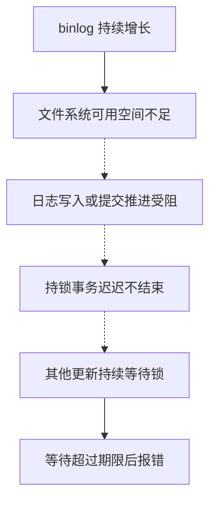

# 从 MySQL 锁等待超时排查到 binlog 容量失控

`Lock wait timeout exceeded` 描述的是一个请求等待锁超时的结果。它没有直接指出谁在阻塞，也没有说明持锁事务为什么迟迟不能结束。当多个更新入口同时失败，又出现提交阶段长事务、临时表写入异常和连接波动时，排查需要从业务 SQL 扩展到事务、日志和文件系统。

一次排查沿着这条路径定位到大量 binlog 挤占磁盘空间；释放空间后，业务恢复可用。值得复用的方法，是逐层建立证据、按恢复依赖安排处置，并把“解除当前故障”与“长期控制增长”分别验收。

以下以 MySQL 8.0 和 InnoDB 为技术范围。案例只保留通用故障现象；容量计算使用重新构造的模拟数据，SQL 为只读诊断模板，验证表描述验收要求。

## 一 从报错位置逐步扩大排查范围

最初的异常落在更新语句上，随后另一个更新入口也出现同类错误。事务快照显示有长时间存活的事务，部分停留在提交阶段；进一步查询时又出现临时表空间异常。主机检查发现相关文件系统可用空间紧张，而主要空间占用来自二进制日志。日志清理后，可用空间明显恢复，业务操作也恢复正常。

这些观察构成了排查路径，但每一条证据能够证明的范围不同：

| 现场观察 | 可以确认什么 | 还需要什么证据 |
| --- | --- | --- |
| 多个入口出现锁等待超时 | 影响不局限于单个更新请求 | 各请求对应的等待方与阻塞方关系 |
| 长事务仍持有锁，部分当前语句为提交 | 事务没有及时结束，提交路径值得关注 | 提交阶段等待事件、错误日志和相关资源状态 |
| 诊断查询出现临时表 `full` | 查询所需的临时存储能力发生异常 | 实际临时路径、限制和对应文件系统状态 |
| 数据库连接短时失败 | 当时连接路径不可用 | 进程状态、监听、服务日志和启动记录 |
| binlog 占用主要磁盘空间 | 日志容量已经成为需要解除的问题 | 日志生成速率、保留配置及清理依赖 |
| 清理后空间与业务恢复 | 处置具有可观察的恢复效果 | 持续运行、失败请求状态和长期策略验收 |

两个容易混淆的判断是：临时表报 `full`，不等于临时目录里一定堆满了文件；一次连接失败，也不等于已经证明数据库进程崩溃。诊断应跟随现场证据修正方向，而不是把最初假设一直延续到底。

## 二 先准确理解锁等待超时

### 1205 与 1213 的含义不同

在 InnoDB 中，错误 `1205` 表示锁等待超时；错误 `1213` 表示死锁受害事务被回滚。默认情况下，锁等待超时只回滚当前超时语句；启用 `innodb_rollback_on_timeout` 时行为才改变为回滚整个事务。死锁则回滚被选中的整个事务。[MySQL InnoDB 错误处理](https://dev.mysql.com/doc/refman/8.0/en/innodb-error-handling.html)

数据库层语句回滚与应用层事务结束也不是同一回事。应用让异常继续传播、显式回滚、捕获后继续执行，可能得到不同的最终事务状态。不能只依据异常类名或一条失败日志，认定整个业务事务已经结束。

### 等待方异常栈不等于阻塞方证据

更新失败的调用栈能找到等待方的入口和 SQL，却不能直接确定阻塞方。即使两个功能在相近时间运行，也需要证明它们竞争同一资源，或存在明确的等待链，才能建立阻塞关系。

同一行上的 `UPDATE` 本身会获取排他锁；删除前面的 `SELECT ... FOR UPDATE` 并不会自动消除写冲突。锁范围还受索引、访问条件与执行路径影响，不能把所有更新等待都简化为“同一个主键被占用”。[MySQL 不同语句设置的锁](https://dev.mysql.com/doc/refman/8.0/en/innodb-locks-set.html)

## 三 在现场保存小而完整的诊断快照

### 保存等待关系与事务状态

MySQL 8.0 可以通过 `performance_schema.data_lock_waits`、`data_locks` 及相关 `sys` 视图观察锁等待。下面使用 `sys.innodb_lock_waits`，省略业务 SQL 原文、客户端地址等信息：

```sql
-- 采集当前等待关系，输出仍须保存在受控排障记录中。
SELECT
    NOW() AS observed_at,
    wait_age_secs,
    waiting_trx_id,
    waiting_pid,
    locked_table_schema,
    locked_table_name,
    locked_index,
    blocking_trx_id,
    blocking_pid,
    blocking_trx_age
FROM sys.innodb_lock_waits
ORDER BY wait_age_secs DESC
LIMIT 30;
```

该快照需要关注等待年龄、锁对象、双方事务身份与会话身份，而不是只找“运行时间最长”的连接。一个事务可以阻塞多笔请求，也可能继续等待其他资源，需要沿关系检查链条。示例只返回最长的部分等待，不能把它当作完整等待图。[MySQL sys 锁等待视图](https://dev.mysql.com/doc/refman/8.0/en/sys-innodb-lock-waits.html)

```sql
-- 保留事务年龄及锁规模，避免只看当前正在执行的 SQL。
SELECT
    NOW() AS observed_at,
    trx_id,
    trx_state,
    trx_mysql_thread_id,
    trx_started,
    TIMESTAMPDIFF(SECOND, trx_started, NOW()) AS trx_age_seconds,
    trx_wait_started,
    trx_rows_locked,
    trx_rows_modified
FROM information_schema.innodb_trx
ORDER BY trx_started
LIMIT 30;
```

查询应使用对应监控权限，`INNODB_TRX` 需要 `PROCESS` 权限。连接当前处于 `Sleep` 或没有当前语句，不代表此前开启的事务已经提交；恢复后的空结果也不能否定此前发生过阻塞。[MySQL 活跃事务信息](https://dev.mysql.com/doc/refman/8.0/en/information-schema-innodb-trx-table.html)

### 诊断查询也可能消耗紧张资源

如果进程查询或排序已经触发临时表错误，应降低诊断查询的复杂度与频率，并转向主机和数据库日志。`LIMIT` 只能限制返回量，不保证前面的连接、排序与临时计算没有成本。

现场记录应带统一时间与时区，尽可能对应同一时间窗口的应用异常、事务快照、提交等待、磁盘状态和错误日志。等待关系会变化，事后仅凭一次快照无法完整重建过去的阻塞链。

## 四 确认空间消耗来自哪里

### 对应路径而不是只看整机总量

至少确认数据目录、binlog、临时目录、错误日志和备份分别落在哪个文件系统。多个目录名字不同，仍可能共用同一个挂载卷；应用服务器有空间，也不能代表数据库服务器有空间。

| 观察维度 | 需要排除的误判 |
| --- | --- |
| 可用字节与 inode | 容量耗尽与 inode 耗尽不是一类问题 |
| 挂载点与目录归属 | 数据、日志、临时文件可能争用同一空间 |
| 配额与只读状态 | 看似有余量，也可能无法继续写入 |
| 数据文件与日志文件 | 表数据体积不能代表实例总磁盘占用 |
| 已删除但仍被打开的文件 | 文件名消失不一定意味着空间已经释放 |
| 数据库错误日志 | 需要区分写入失败、权限问题、异常退出和恢复过程 |

目录统计应限于相关路径，避免在 I/O 已经紧张时高频扫描整个文件系统。binlog 清单可以通过数据库获取，再与主机文件系统指标交叉核对。

### 核对生效配置与日志清单

```sql
-- 查看实际配置，不修改任何参数。
SHOW GLOBAL VARIABLES
WHERE Variable_name IN (
    'innodb_lock_wait_timeout',
    'innodb_rollback_on_timeout',
    'binlog_expire_logs_seconds',
    'binlog_expire_logs_auto_purge',
    'max_binlog_size',
    'binlog_error_action'
);

-- 按返回的 File_size 汇总二进制日志体积。
SHOW BINARY LOGS;
```

配置项需按版本解释，例如自动清理开关并非所有 MySQL 8.0 小版本都存在。该查询返回全局值，故障请求所在连接的会话级锁等待参数仍需单独核对；排查连接自己的会话值，也不能代替故障连接的实际值。

还应检查运行配置与持久配置是否一致，不能只查看配置文件文本就认定当前进程已经使用它。

## 五 容量异常为什么可能表现为锁等待

binlog 写入参与事务提交过程，发生在事务完成、释放相关锁之前。磁盘满可能影响 binlog 及其索引文件的写入，因此提交路径受阻、持锁时间被拉长，是需要结合现场证据验证的机制。[MySQL 二进制日志与提交顺序](https://dev.mysql.com/doc/refman/8.0/en/binary-log.html)、[MySQL 磁盘满处理](https://dev.mysql.com/doc/refman/8.0/en/full-disk.html)

可以用下面的机制图安排取证。虚线表示需要补充提交等待、错误日志和阻塞关系才能确认的因果环节：



磁盘错误的具体行为还取决于写入对象、版本和配置，不能把某一类文件的处理策略推广为所有 InnoDB 操作都会以同一种方式挂起。

在这个案例中，空间故障和清理后的恢复有直接观察支持；若要把最初每一笔锁超时都归因到某个提交阻塞，仍需要当时的锁等待链与提交阶段证据。这个区分直接影响后续措施：容量治理和应用事务治理都可能有价值，但不能互相替代。

## 六 先保护现场再恢复容量与业务

### 限制故障期间的额外压力

故障期间先减少会扩大写入或锁竞争的批量任务、无界重试和重复点击，并保留正在处理请求的身份与状态。重试之前检查前一次是否已经提交，不能把客户端超时自动解释为“数据库没有发生变化”。

终止会话、重启实例或调整业务并发，应由有权限的操作人员根据现场状态执行。不能仅按事务年龄批量结束会话，也不能把重启当作释放日志空间的方法。大事务回滚本身需要时间和资源。

### 按依赖确定 binlog 清理边界

binlog 可能被复制、变更数据捕获和备份恢复链使用。没有看到当前复制连接，不足以证明没有离线副本或其他消费者；也不能因为日志占用大，就认定这些文件都可以删除。

清理前应确认：

1. 所有副本与消费端仍需要的最早日志位置，包括暂时离线的节点。
2. 最近可用全量备份、增量链及时间点恢复所需的日志范围。
3. 已归档日志是否完整、可读取并通过恢复验证。
4. 本地实际可以释放的范围，以及释放后能否支撑当前写入与恢复过程。

使用 MySQL 支持的 `PURGE BINARY LOGS` 维护日志清单；`TO` 边界删除目标文件之前的日志，目标文件本身保留。不要用文件系统通配符删除 binlog，或把重置日志历史当作常规清理手段。[MySQL PURGE 语义](https://dev.mysql.com/doc/refman/8.0/en/purge-binary-logs.html)

时间点恢复依赖备份之后的必要二进制日志。清理策略必须同时满足恢复目标，而不只满足“现在腾出空间”。[MySQL 时间点恢复](https://dev.mysql.com/doc/refman/8.0/en/point-in-time-recovery-binlog.html)

### 用实际结果确认处置生效

清理后核对日志清单与文件系统可用空间，再观察错误日志、提交延迟和等待关系。若不能安全删除现有日志，恢复方案应转向受控扩容、已验证的归档路径或其他明确可回收对象，不能越过恢复依赖强行缩短保留窗口。

## 七 将恢复拆成四层验收

磁盘空间释放、数据库可连接、业务写入正常、失败请求处理完成，是四个不同层次。一次登录成功或页面不再报错，不能替代后面的验证。

| 层次 | 验收内容 | 不能代替的结论 |
| --- | --- | --- |
| 资源恢复 | 可用空间、inode、写权限和增长速率回到可接受范围 | 不代表所有事务已经结束 |
| 数据库恢复 | 提交可推进，长事务与锁等待无持续异常 | 不代表失败请求已得到正确处理 |
| 业务恢复 | 用受控请求验证写入、重查和必要的外部副作用 | 不代表所有历史操作都没有重复或遗漏 |
| 故障收尾 | 核对超时与中断请求，确认提交、回滚或可补偿状态 | 不代表未来不会再次容量耗尽 |

需要重试的操作应带业务幂等身份，并检查原请求最终状态。尤其在提交响应丢失、连接中断或应用重试的情况下，要同时防止重复计数、重复外部调用和遗漏后续处理。

业务可用性恢复可以作为应急阶段的结束信号；保留策略、监控与容量规划则应分别验证生效，不能合并为一句“已经彻底解决”。

## 八 用增长率与恢复目标设计保留策略

### 时间保留不等于容量上限

`binlog_expire_logs_seconds` 约束日志保留时间，不约束总字节数；`max_binlog_size` 是单文件轮转阈值，大事务还可能让单个文件超过该值。即使过期清理正常工作，保留窗口内的日志也可能超过磁盘预算。[MySQL binlog 配置](https://dev.mysql.com/doc/refman/8.0/en/replication-options-binary-log.html)

到期日志清理会在启动、日志刷新等时机检查，并受对应版本的自动清理开关控制。配置了保留时间，不等于文件一过期就由一个独立定时器立即删除。[MySQL 日志维护](https://dev.mysql.com/doc/refman/8.0/en/log-file-maintenance.html)

### 同时计算需要保留多久与实际放得下多少

```text
所需在线保留窗口
  = max(复制及消费恢复所需窗口, 备份与恢复方案要求的在线窗口)

预计 binlog 占用
  = 设计增长率 × 所需在线保留窗口 + 突发写入余量

可用 binlog 预算
  = 文件系统容量 - 数据及其他日志预算 - 临时与恢复余量 - 安全保留空间
```

假设一个完全模拟的环境，binlog 可用预算为 240 GiB，设计增长率为每天 60 GiB，而恢复方案要求在线保留七天。仅基础日志就需要 420 GiB，尚未计入突发余量，说明保留需求与容量设计不匹配。

正确的调整方向是增加空间、减少不必要的写入、优化日志生成来源，或建立满足恢复目标的归档方案。不能只为适应现有磁盘，就把恢复窗口压缩到业务无法接受的程度。

配置变更应核对作用域、当前生效值、持久化位置及重启后的结果。特别是具有会话作用域的参数，修改全局默认值不代表已有连接池会话会自动更新。[MySQL 系统变量作用域](https://dev.mysql.com/doc/refman/8.0/en/set-variable.html)

## 九 主机监控与数据库巡检各自负责什么

### 不用数据库对象体积推算主机剩余空间

`SHOW BINARY LOGS` 能提供二进制日志清单与大小，库表统计能描述部分数据库对象规模，但两者不能反推出整个文件系统的可用字节。其他文件、预留空间、配额和不同挂载关系都会影响实际可写能力。

主机侧采集文件系统与 I/O 指标，数据库侧采集日志、事务和连接指标，应用侧采集请求失败与重试情况。部署主机采集器时要确认它观察的是数据库主机及正确挂载点，而不是采集器容器自己的文件系统。[Prometheus node_exporter](https://github.com/prometheus/node_exporter)

| 层次 | 核心指标 | 告警之后的动作 |
| --- | --- | --- |
| 主机 | 可用字节、inode、只读状态、I/O 延迟 | 定位对应挂载点与主要增长来源 |
| binlog | 总体积、单位时间生成量、保留配置与清理结果 | 对照容量预算及消费者所需窗口 |
| 事务 | 最老事务年龄、提交等待、锁等待数量与持续时间 | 获取阻塞关系并关联应用请求 |
| 应用 | 写入失败率、提交耗时、重试量、连接池等待 | 降低额外压力，核对请求最终状态 |

### 用剩余处置时间补充使用率告警

```text
预计耗尽时间 = 当前可用空间 / 持续为正的净消耗速率
```

这个估算需要说明采样窗口，并处理清理造成的下降、写入突增、速率接近零等情况。更实用的预警条件是：预计耗尽时间已经小于响应、处置与安全余量之和，而不是等某个固定使用率才开始行动。

监控还应有缺数、采集失败和清理失败告警。告警必须能指向负责人、处置入口与恢复标准，避免只把一张容量图放到看板上。

## 十 容量恢复之后继续收紧事务边界

若现场链路证明事务内包含远端请求、大文件处理或其他长耗时工作，可以评估将其拆出持锁区间。但这是独立的应用治理方向，不能直接作为容量故障已经修复的证明。

一种可采用的结构是：

1. 第一个短事务记录输入版本、预期状态和执行轮次。
2. 在事务外执行可独立重试的远端工作，并保存结果身份。
3. 第二个短事务按主键、预期状态、输入版本和执行轮次条件写回。
4. 条件不满足时按过期或冲突处理，不覆盖已经改变的数据。

拆分之后要明确幂等、补偿和外部效果的恢复方式。缩短事务不能以丢失一致性为代价；仅增加锁等待时间，也不能修复日志空间不足或持锁事务不结束的问题。

将这类故障沉淀为工程能力，需要同时做到三件事：用现场关系识别阻塞，用资源证据解释异常范围，用容量与恢复约束设计长期策略。空间释放证明应急动作有效，持续增长受到控制、失败请求得到核对，才形成更完整的恢复闭环。
