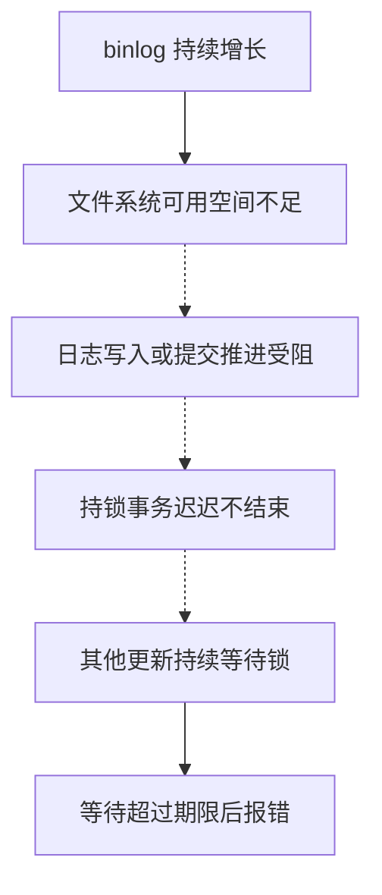

# 从 MySQL 锁等待超时排查到 binlog 容量失控

`Lock wait timeout exceeded` 描述的是一个请求等待锁超时的结果。它没有直接指出谁在阻塞，也没有说明持锁事务为什么迟迟不能结束。当多个更新入口同时失败，又出现提交阶段长事务、临时表写入异常和连接波动时，排查需要从业务 SQL 扩展到事务、日志和文件系统。

一次排查沿着这条路径定位到大量 binlog 挤占磁盘空间；释放空间后，业务恢复可用。值得复用的方法，是逐层建立证据、按恢复依赖安排处置，并把“解除当前故障”与“长期控制增长”分别验收。

以下以 MySQL 8.0 和 InnoDB 为主，命令部分补充 MySQL 5.7、8.4 的差异。主机示例适用于 GNU/Linux。路径、文件名、日期和保留期均为演示值；查询与变更命令分别列出，验证表描述验收要求。

## 一 从报错位置逐步扩大排查范围

最初的异常落在更新语句上，随后另一个更新入口也出现同类错误。事务快照显示有长时间存活的事务，部分停留在提交阶段；进一步查询时又出现临时表空间异常。主机检查发现相关文件系统可用空间紧张，而主要空间占用来自二进制日志。日志清理后，可用空间明显恢复，业务操作也恢复正常。

这些观察构成了排查路径，但每一条证据能够证明的范围不同：

| 现场观察 | 可以确认什么 | 还需要什么证据 |
| --- | --- | --- |
| 多个入口出现锁等待超时 | 影响不局限于单个更新请求 | 各请求对应的等待方与阻塞方关系 |
| 长事务仍持有锁，部分当前语句为提交 | 事务没有及时结束，提交路径值得关注 | 提交阶段等待事件、错误日志和相关资源状态 |
| 诊断查询出现临时表 `full` | 查询所需的临时存储能力发生异常 | 实际临时路径、限制和对应文件系统状态 |
| 数据库连接短时失败 | 当时连接路径不可用 | 进程状态、监听、服务日志和启动记录 |
| binlog 占用主要磁盘空间 | 日志容量已经成为需要解除的问题 | 日志生成速率、保留配置及清理依赖 |
| 清理后空间与业务恢复 | 处置具有可观察的恢复效果 | 持续运行、失败请求状态和长期策略验收 |

两个容易混淆的判断是：临时表报 `full`，不等于临时目录里一定堆满了文件；一次连接失败，也不等于已经证明数据库进程崩溃。诊断应跟随现场证据修正方向，而不是把最初假设一直延续到底。

## 二 先准确理解锁等待超时

### 1205 与 1213 的含义不同

在 InnoDB 中，错误 `1205` 表示锁等待超时；错误 `1213` 表示死锁受害事务被回滚。默认情况下，锁等待超时只回滚当前超时语句；启用 `innodb_rollback_on_timeout` 时行为才改变为回滚整个事务。死锁则回滚被选中的整个事务。[MySQL InnoDB 错误处理](https://dev.mysql.com/doc/refman/8.0/en/innodb-error-handling.html)

数据库层语句回滚与应用层事务结束也不是同一回事。应用让异常继续传播、显式回滚、捕获后继续执行，可能得到不同的最终事务状态。不能只依据异常类名或一条失败日志，认定整个业务事务已经结束。

### 等待方异常栈不等于阻塞方证据

更新失败的调用栈能找到等待方的入口和 SQL，却不能直接确定阻塞方。即使两个功能在相近时间运行，也需要证明它们竞争同一资源，或存在明确的等待链，才能建立阻塞关系。

同一行上的 `UPDATE` 本身会获取排他锁；删除前面的 `SELECT ... FOR UPDATE` 并不会自动消除写冲突。锁范围还受索引、访问条件与执行路径影响，不能把所有更新等待都简化为“同一个主键被占用”。[MySQL 不同语句设置的锁](https://dev.mysql.com/doc/refman/8.0/en/innodb-locks-set.html)

## 三 在现场保存小而完整的诊断快照

### 保存等待关系与事务状态

MySQL 8.0 可以通过 `performance_schema.data_lock_waits`、`data_locks` 及相关 `sys` 视图观察锁等待。下面使用 `sys.innodb_lock_waits`，省略业务 SQL 原文、客户端地址等信息：

```sql
-- 采集当前等待关系，输出仍须保存在受控排障记录中。
SELECT
    NOW() AS observed_at,
    wait_age_secs,
    waiting_trx_id,
    waiting_pid,
    locked_table_schema,
    locked_table_name,
    locked_index,
    blocking_trx_id,
    blocking_pid,
    blocking_trx_age
FROM sys.innodb_lock_waits
ORDER BY wait_age_secs DESC
LIMIT 30;
```

该快照需要关注等待年龄、锁对象、双方事务身份与会话身份，而不是只找“运行时间最长”的连接。一个事务可以阻塞多笔请求，也可能继续等待其他资源，需要沿关系检查链条。示例只返回最长的部分等待，不能把它当作完整等待图。[MySQL sys 锁等待视图](https://dev.mysql.com/doc/refman/8.0/en/sys-innodb-lock-waits.html)

```sql
-- 保留事务年龄及锁规模，避免只看当前正在执行的 SQL。
SELECT
    NOW() AS observed_at,
    trx_id,
    trx_state,
    trx_mysql_thread_id,
    trx_started,
    TIMESTAMPDIFF(SECOND, trx_started, NOW()) AS trx_age_seconds,
    trx_wait_started,
    trx_rows_locked,
    trx_rows_modified
FROM information_schema.innodb_trx
ORDER BY trx_started
LIMIT 30;
```

查询应使用对应监控权限，`INNODB_TRX` 需要 `PROCESS` 权限。连接当前处于 `Sleep` 或没有当前语句，不代表此前开启的事务已经提交；恢复后的空结果也不能否定此前发生过阻塞。[MySQL 活跃事务信息](https://dev.mysql.com/doc/refman/8.0/en/information-schema-innodb-trx-table.html)

### 诊断查询也可能消耗紧张资源

如果进程查询或排序已经触发临时表错误，应降低诊断查询的复杂度与频率，并转向主机和数据库日志。`LIMIT` 只能限制返回量，不保证前面的连接、排序与临时计算没有成本。

现场记录应带统一时间与时区，尽可能对应同一时间窗口的应用异常、事务快照、提交等待、磁盘状态和错误日志。等待关系会变化，事后仅凭一次快照无法完整重建过去的阻塞链。

## 四 确认空间消耗来自哪里

### 对应路径而不是只看整机总量

至少确认数据目录、binlog、临时目录、错误日志和备份分别落在哪个文件系统。多个目录名字不同，仍可能共用同一个挂载卷；应用服务器有空间，也不能代表数据库服务器有空间。

| 观察维度 | 需要排除的误判 |
| --- | --- |
| 可用字节与 inode | 容量耗尽与 inode 耗尽不是一类问题 |
| 挂载点与目录归属 | 数据、日志、临时文件可能争用同一空间 |
| 配额与只读状态 | 看似有余量，也可能无法继续写入 |
| 数据文件与日志文件 | 表数据体积不能代表实例总磁盘占用 |
| 已删除但仍被打开的文件 | 文件名消失不一定意味着空间已经释放 |
| 数据库错误日志 | 需要区分写入失败、权限问题、异常退出和恢复过程 |

### 在 Linux 上按挂载点查空间

先从下一节的 SQL 取得 `datadir`、`log_bin_basename`、`tmpdir` 与 `log_error`，再在 MySQL 进程能看到这些路径的环境中查询。`log_bin_basename` 包含路径和文件前缀，取其所在目录作为查询路径。对数据、临时文件、错误日志和备份所在目录分别核对；容器内外路径不同时，先确认卷映射。若错误日志输出到标准错误，则核对实际接管输出的服务或容器日志。

```bash
target_dir=/srv/mysql-demo/binlog
findmnt -T "$target_dir" -o TARGET,SOURCE,FSTYPE,OPTIONS
df -hT -- "$target_dir"
df -i -- "$target_dir"
lsblk -f
```

`findmnt` 给出路径实际所在的挂载点、来源和挂载选项；`df -hT` 看 `Avail`、`Use%`，`df -i` 看 inode 余量。`lsblk -f` 用于追查本地块设备，不能代替对网络盘或容器卷的路径查询。[GNU Coreutils 手册源文档](https://raw.githubusercontent.com/coreutils/coreutils/master/doc/coreutils.texi)、[util-linux findmnt 手册](https://github.com/util-linux/util-linux/blob/master/misc-utils/findmnt.8.adoc)

确认挂载点后，先看一级占用，再进入较大的目录。以下假设 `findmnt` 返回的挂载点为 `/srv/mysql-demo`：

```bash
mount_point=/srv/mysql-demo
du -x -h --max-depth=1 -- "$mount_point" | sort -hr | head -n 20

target_dir=/srv/mysql-demo/binlog
find "$target_dir" -xdev -type f -size +1G -printf '%s\t%p\n' |
    sort -nr | head -n 20
```

`du` 默认统计磁盘占用，`find -size` 按逻辑大小筛选，`%s` 显示逻辑字节数；稀疏文件的逻辑大小和实际占用可能差很多。`-x` 和 `-xdev` 限制跨文件系统扫描，不能据此断定同一文件系统的绑定挂载已被排除。`--max-depth=1` 和 `head` 限制展示范围，仍需遍历下层文件；I/O 紧张时优先扫描已知目录，留意权限错误。[GNU find 手册](https://man7.org/linux/man-pages/man1/find.1.html)

如果 `df` 显示占用很高，而 `du` 找不到相应文件，先确认挂载位置、扫描权限和存储快照，再由有相应权限的操作人员查看已删除但仍打开的文件：

```bash
lsof -nP +L1
```

按进程、设备和路径核对输出。打开的文件即使已删除目录项，通常也要等最后一个引用关闭才会释放空间。确认文件用途后按服务维护流程关闭或轮转，避免直接截断文件描述符或终止数据库进程。[lsof 手册](https://raw.githubusercontent.com/lsof-org/lsof/master/Lsof.8)、[Linux unlink 手册](https://man7.org/linux/man-pages/man2/unlink.2.html#DESCRIPTION)

### 查询 binlog 路径、容量和当前位置

```sql
-- 查看实际配置，不修改任何参数。
SELECT VERSION() AS mysql_version;

SHOW GLOBAL VARIABLES
WHERE Variable_name IN (
    'datadir',
    'tmpdir',
    'log_error',
    'log_bin',
    'log_bin_basename',
    'log_bin_index',
    'innodb_lock_wait_timeout',
    'innodb_rollback_on_timeout',
    'expire_logs_days',
    'binlog_expire_logs_seconds',
    'binlog_expire_logs_auto_purge',
    'max_binlog_size',
    'binlog_error_action'
);

-- 按返回的 File_size 汇总二进制日志体积。
SHOW BINARY LOGS;
```

先看 `log_bin` 是否开启。`SHOW BINARY LOGS` 中的 `Log_name` 和 `File_size` 分别表示日志名和字节数；总和可用于估算 binlog 规模，并与主机文件占用对照。下例使用已配置的演示登录路径 `demo`，查询失败时不会把空结果报为 0：

```bash
binlogs=$(mysql --login-path=demo --batch --skip-column-names -e 'SHOW BINARY LOGS') &&
    printf '%s\n' "$binlogs" |
    awk 'NF >= 2 { bytes += $2; count++ }
         END { if (count) printf "%d files, %.2f GiB\n", count, bytes / 1073741824 }'
```

| 用途 | MySQL 5.7 | MySQL 8.0 | MySQL 8.4 |
| --- | --- | --- | --- |
| 列出实例的 binlog | `SHOW BINARY LOGS;` | `SHOW BINARY LOGS;` | `SHOW BINARY LOGS;` |
| 查源库当前写入文件与位置 | `SHOW MASTER STATUS;` | `SHOW MASTER STATUS;` | `SHOW BINARY LOG STATUS;` |
| 查副本复制状态 | `SHOW SLAVE STATUS\G` | 从 8.0.22 起用 `SHOW REPLICA STATUS\G`，更早版本用 `SHOW SLAVE STATUS\G` | `SHOW REPLICA STATUS\G` |

表中的 `\G` 是 `mysql` 终端客户端的纵向输出结尾，其他 SQL 客户端用分号即可。清单、当前位置和副本进度各自回答不同问题；当前正在写的文件通常不是应该保留的最早文件。[日志清单](https://dev.mysql.com/doc/refman/8.4/en/show-binary-logs.html)、[副本状态](https://dev.mysql.com/doc/refman/8.0/en/show-replica-status.html)、[MySQL 8.4 命令变更](https://dev.mysql.com/doc/relnotes/mysql/8.4/en/news-8-4-0.html)

需要定位具体事件时，先限定文件和返回行数；本地只检查授权保存的未加密副本，按事件位置缩小范围：

```sql
SHOW BINLOG EVENTS IN 'demo-bin.000120' FROM 4 LIMIT 20;
```

```bash
mysqlbinlog --base64-output=DECODE-ROWS -vv \
    --start-position=4 --stop-position=4096 \
    /srv/mysql-demo/archive/demo-bin.000120
```

`SHOW BINLOG EVENTS` 不展示所有事件；`mysqlbinlog` 的偏移量用实际事件边界替换示例值。加密日志不能用该方式直接解码本地文件，需要通过 MySQL 服务端读取。解码结果可能包含真实业务数据，应限制输出范围并留在受控环境；上面的解码模式仅用于检查。[SHOW BINLOG EVENTS](https://dev.mysql.com/doc/refman/8.0/en/show-binlog-events.html)、[mysqlbinlog 手册](https://dev.mysql.com/doc/refman/8.0/en/mysqlbinlog.html)

全局变量查询只返回该版本存在的项目。对有会话作用域的锁等待参数，仍须核对故障连接的实际值；排查连接自己的会话值不能代替它。

## 五 容量异常为什么可能表现为锁等待

binlog 写入参与事务提交过程，发生在事务完成、释放相关锁之前。磁盘满可能影响 binlog 及其索引文件的写入，因此提交路径受阻、持锁时间被拉长，是需要结合现场证据验证的机制。[MySQL 二进制日志与提交顺序](https://dev.mysql.com/doc/refman/8.0/en/binary-log.html)、[MySQL 磁盘满处理](https://dev.mysql.com/doc/refman/8.0/en/full-disk.html)

可以用下面的机制图安排取证。虚线表示需要补充提交等待、错误日志和阻塞关系才能确认的因果环节：



磁盘错误的具体行为还取决于写入对象、版本和配置，不能把某一类文件的处理策略推广为所有 InnoDB 操作都会以同一种方式挂起。

在这个案例中，空间故障和清理后的恢复有直接观察支持；若要把最初每一笔锁超时都归因到某个提交阻塞，仍需要当时的锁等待链与提交阶段证据。这个区分直接影响后续措施：容量治理和应用事务治理都可能有价值，但不能互相替代。

## 六 先保护现场再恢复容量与业务

### 限制故障期间的额外压力

故障期间先减少会扩大写入或锁竞争的批量任务、无界重试和重复点击，并保留正在处理请求的身份与状态。重试之前检查前一次是否已经提交，不能把客户端超时自动解释为“数据库没有发生变化”。

终止会话、重启实例或调整业务并发，应由有权限的操作人员根据现场状态执行。不能仅按事务年龄批量结束会话，也不能把重启当作释放日志空间的方法。大事务回滚本身需要时间和资源。

### 按依赖确定 binlog 清理边界

binlog 可能被复制、变更数据捕获和备份恢复链使用。没有看到当前复制连接，不足以证明没有离线副本或其他消费者；也不能因为日志占用大，就认定这些文件都可以删除。

清理前应确认：

1. 所有副本与消费端仍需要的最早日志位置，包括暂时离线的节点。
2. 最近可用全量备份、增量链及时间点恢复所需的日志范围。
3. 已归档日志是否完整、可读取并通过恢复验证。
4. 本地实际可以释放的范围，以及释放后能否支撑当前写入与恢复过程。

在每个副本的每条复制通道查源库读取进度：新版看 `Source_Log_File` 和 `Read_Source_Log_Pos`，旧版对应 `Master_Log_File` 和 `Read_Master_Log_Pos`。`Relay_Log_File` 指的是副本本地文件，延迟秒数也不能直接换算出源库可删除的文件。遇到位点未知、离线或断连的副本，要另核其恢复所需位置。在线副本正从源库读取的文件可受到 MySQL 保护，但这不覆盖离线副本、CDC 与备份恢复。

时间点恢复依赖备份之后的必要二进制日志。清理策略必须同时满足恢复目标，而不只满足“现在腾出空间”。[MySQL 时间点恢复](https://dev.mysql.com/doc/refman/8.0/en/point-in-time-recovery-binlog.html)

### 用 PURGE 按文件边界清理

在目标源库核对 `SHOW BINARY LOGS`，从副本、CDC 检查点和时间点恢复所需日志中取最早必须保留的文件。在准备清理的文件区间，如果依赖外部归档，先检查日志是否连续、能否读回，并核对恢复位点。只在边界已确认后由有权限的人员执行；MySQL 8.0 和 8.4 使用 `BINLOG_ADMIN`，5.7 使用 `SUPER`。[MySQL 5.7 权限说明](https://docs.oracle.com/cd/E17952_01/mysql-5.7-en/privileges-provided.html)

```sql
-- 模拟：清单中 demo-bin.000123 是必须保留的第一个文件。
-- 它之前的整份日志文件才会被删除，它自身不会被删除。
PURGE BINARY LOGS TO 'demo-bin.000123';
SHOW WARNINGS;
SHOW BINARY LOGS;
```

另有按时间清理的语法，例如 `PURGE BINARY LOGS BEFORE '2026-01-08 00:00:00';`。它按文件修改时间选择旧文件，不会截断日志或按事务时间逐条删除。使用前先核对 `SELECT @@session.time_zone, NOW();` 及实际文件范围；文件与依赖已经明确时，优先用 `TO`。[MySQL PURGE 语义](https://dev.mysql.com/doc/refman/8.0/en/purge-binary-logs.html)、[MySQL 8.4 文件时间比较实现](https://github.com/mysql/mysql-server/blob/mysql-8.4.0/sql/binlog.cc#L5950-L5967)

MySQL 会同步维护索引文件，禁止用文件系统命令直接删除 binlog 或修改 `.index` 来绕过清理。`RESET MASTER` 和 `RESET BINARY LOGS AND GTIDS` 也不用于常规清理，它们会重置日志历史，并可能影响 GTID 状态。[MySQL 8.4 重置语义](https://dev.mysql.com/doc/refman/8.4/en/reset-binary-logs-and-gtids.html)

`FLUSH BINARY LOGS;` 用于主动轮转，会创建新的日志文件，也可能触发到期清理。它属于维护操作；满盘时先确认能否安全回收空间或扩容，不要把轮转当作必然腾出空间的办法。[MySQL FLUSH 语句](https://dev.mysql.com/doc/refman/8.0/en/flush.html)

### 用实际结果确认处置生效

清理后先看警告和日志清单，确认应保留的首个文件仍在；对同一目录重跑 `df -hT`，再复查复制及 CDC 是否继续推进，观察错误日志、提交延迟和等待关系。若命令失败或没有达到预期回收量，先查报错和依赖；无法安全删除时，转向受控扩容或其他明确可回收对象。

## 七 将恢复拆成四层验收

磁盘空间释放、数据库可连接、业务写入正常、失败请求处理完成，是四个不同层次。一次登录成功或页面不再报错，不能替代后面的验证。

| 层次 | 验收内容 | 不能代替的结论 |
| --- | --- | --- |
| 资源恢复 | 可用空间、inode、写权限和增长速率回到可接受范围 | 不代表所有事务已经结束 |
| 数据库恢复 | 提交可推进，长事务与锁等待无持续异常 | 不代表失败请求已得到正确处理 |
| 业务恢复 | 用受控请求验证写入、重查和必要的外部副作用 | 不代表所有历史操作都没有重复或遗漏 |
| 故障收尾 | 核对超时与中断请求，确认提交、回滚或可补偿状态 | 不代表未来不会再次容量耗尽 |

需要重试的操作应带业务幂等身份，并检查原请求最终状态。尤其在提交响应丢失、连接中断或应用重试的情况下，要同时防止重复计数、重复外部调用和遗漏后续处理。

业务可用性恢复可以作为应急阶段的结束信号；保留策略、监控与容量规划则应分别验证生效，不能合并为一句“已经彻底解决”。

## 八 用增长率与恢复目标设计保留策略

### 时间保留不等于容量上限

`binlog_expire_logs_seconds` 约束日志保留时间，不约束总字节数；`max_binlog_size` 是单文件轮转阈值，大事务还可能让单个文件超过该值。即使过期清理正常工作，保留窗口内的日志也可能超过磁盘预算。[MySQL binlog 配置](https://dev.mysql.com/doc/refman/8.0/en/replication-options-binary-log.html)

到期日志清理会在启动、日志刷新等时机检查，并受对应版本的自动清理开关控制。配置了保留时间，不等于文件一过期就由一个独立定时器立即删除。[MySQL 日志维护](https://dev.mysql.com/doc/refman/8.0/en/log-file-maintenance.html)

### 按版本修改并复核保留期

| 版本 | 保留变量 | 设置时的注意事项 |
| --- | --- | --- |
| MySQL 5.7 | `expire_logs_days`，单位为天 | 默认 `0`，不自动清理；用 `SET GLOBAL` 修改当前值，另写入实际生效的配置文件才能跨重启保留。 |
| MySQL 8.0 | `binlog_expire_logs_seconds`，单位为秒 | 仍有弃用的 `expire_logs_days`。迁移时先核对旧变量，若非零，要先把旧值清零并清理旧持久设置，再启用秒级配置。从 8.0.29 起还需检查 `binlog_expire_logs_auto_purge`。 |
| MySQL 8.4 | `binlog_expire_logs_seconds`，单位为秒 | `expire_logs_days` 已在 8.2 移除；自动清理开关为 `OFF` 或秒数为 `0` 时，不按保留期自动清理。 |

参见 [MySQL 5.7 binlog 参数](https://dev.mysql.com/doc/mysql-replication-excerpt/5.7/en/replication-options-binary-log.html#sysvar_expire_logs_days)、[MySQL 8.0 binlog 参数](https://dev.mysql.com/doc/refman/8.0/en/replication-options-binary-log.html#sysvar_binlog_expire_logs_seconds)、[MySQL 8.2 参数移除说明](https://dev.mysql.com/doc/relnotes/mysql/8.4/en/news-8-2-0.html)、[MySQL 8.4 binlog 参数](https://dev.mysql.com/doc/refman/8.4/en/replication-options-binary-log.html#sysvar_binlog_expire_logs_seconds)。

以下以 **7 天（604800 秒）** 演示语法。按复制、CDC、备份和容量要求计算实际值。缩短保留期后，下一次自动清理可能删除现有文件，应先按第六节确认依赖。

```sql
-- MySQL 8.0 / 8.4：仅修改运行值，或改用 SET PERSIST 同时保存；二选一。
SET GLOBAL binlog_expire_logs_seconds = 604800;
-- SET PERSIST binlog_expire_logs_seconds = 604800;
```

```sql
-- MySQL 5.7：仅修改运行值。
SET GLOBAL expire_logs_days = 7;
```

若以配置文件统一管理，在实际生效的 `[mysqld]` 段按版本选一项：5.7 写 `expire_logs_days=7`，8.0 或 8.4 写 `binlog_expire_logs_seconds=604800`。MySQL 8.0.29 及以上可用 `SET GLOBAL binlog_expire_logs_auto_purge = ON;` 恢复自动清理，先确认关闭开关的原因和恢复窗口。`log_bin` 的启用及路径属于启动配置，不能用 `SET GLOBAL` 在线切换。托管数据库通过服务商支持的参数管理方式配置。

使用 `SET PERSIST` 时，MySQL 会写入数据目录的 `mysqld-auto.cnf`。启用持久配置加载时，这里的同名值会覆盖普通配置；不要手改该文件。需要回到配置文件统一管理时，在核对新配置后用 `RESET PERSIST IF EXISTS binlog_expire_logs_seconds;` 删除对应的持久覆盖，它不会改动当前运行值。变更后重查第四节的全局变量，安排重启后的复核，并在下一次正常轮转后对比日志清单、归档连续性和实际磁盘余量。[MySQL 持久化参数](https://dev.mysql.com/doc/refman/8.0/en/persisted-system-variables.html)、[RESET PERSIST](https://dev.mysql.com/doc/refman/8.0/en/reset-persist.html)

### 同时计算需要保留多久与实际放得下多少

```text
所需在线保留窗口
  = max(复制及消费恢复所需窗口, 备份与恢复方案要求的在线窗口)

预计 binlog 占用
  = 设计增长率 × 所需在线保留窗口 + 突发写入余量

可用 binlog 预算
  = 文件系统容量 - 数据及其他日志预算 - 临时与恢复余量 - 安全保留空间
```

假设一个完全模拟的环境，binlog 可用预算为 240 GiB，设计增长率为每天 60 GiB，而恢复方案要求在线保留七天。仅基础日志就需要 420 GiB，尚未计入突发余量，说明保留需求与容量设计不匹配。

正确的调整方向是增加空间、减少不必要的写入、优化日志生成来源，或建立满足恢复目标的归档方案。不能只为适应现有磁盘，就把恢复窗口压缩到业务无法接受的程度。

配置变更应核对作用域、当前生效值、持久化位置及重启后的结果。特别是具有会话作用域的参数，修改全局默认值不代表已有连接池会话会自动更新。[MySQL 系统变量作用域](https://dev.mysql.com/doc/refman/8.0/en/set-variable.html)

## 九 主机监控与数据库巡检各自负责什么

### 不用数据库对象体积推算主机剩余空间

`SHOW BINARY LOGS` 能提供二进制日志清单与大小，库表统计能描述部分数据库对象规模，但两者不能反推出整个文件系统的可用字节。其他文件、预留空间、配额和不同挂载关系都会影响实际可写能力。

主机侧采集文件系统与 I/O 指标，数据库侧采集日志、事务和连接指标，应用侧采集请求失败与重试情况。部署主机采集器时要确认它观察的是数据库主机及正确挂载点，而不是采集器容器自己的文件系统。[Prometheus node_exporter](https://github.com/prometheus/node_exporter)

| 层次 | 核心指标 | 告警之后的动作 |
| --- | --- | --- |
| 主机 | 可用字节、inode、只读状态、I/O 延迟 | 定位对应挂载点与主要增长来源 |
| binlog | 总体积、单位时间生成量、保留配置与清理结果 | 对照容量预算及消费者所需窗口 |
| 事务 | 最老事务年龄、提交等待、锁等待数量与持续时间 | 获取阻塞关系并关联应用请求 |
| 应用 | 写入失败率、提交耗时、重试量、连接池等待 | 降低额外压力，核对请求最终状态 |

### 用剩余处置时间补充使用率告警

```text
预计耗尽时间 = 当前可用空间 / 持续为正的净消耗速率
```

这个估算需要说明采样窗口，并处理清理造成的下降、写入突增、速率接近零等情况。更实用的预警条件是：预计耗尽时间已经小于响应、处置与安全余量之和，而不是等某个固定使用率才开始行动。

监控还应有缺数、采集失败和清理失败告警。告警必须能指向负责人、处置入口与恢复标准，避免只把一张容量图放到看板上。

## 十 容量恢复之后继续收紧事务边界

若现场链路证明事务内包含远端请求、大文件处理或其他长耗时工作，可以评估将其拆出持锁区间。但这是独立的应用治理方向，不能直接作为容量故障已经修复的证明。

一种可采用的结构是：

1. 第一个短事务记录输入版本、预期状态和执行轮次。
2. 在事务外执行可独立重试的远端工作，并保存结果身份。
3. 第二个短事务按主键、预期状态、输入版本和执行轮次条件写回。
4. 条件不满足时按过期或冲突处理，不覆盖已经改变的数据。

拆分之后要明确幂等、补偿和外部效果的恢复方式。缩短事务不能以丢失一致性为代价；仅增加锁等待时间，也不能修复日志空间不足或持锁事务不结束的问题。

将这类故障沉淀为工程能力，需要同时做到三件事：用现场关系识别阻塞，用资源证据解释异常范围，用容量与恢复约束设计长期策略。空间释放证明应急动作有效，持续增长受到控制、失败请求得到核对，才形成更完整的恢复闭环。
