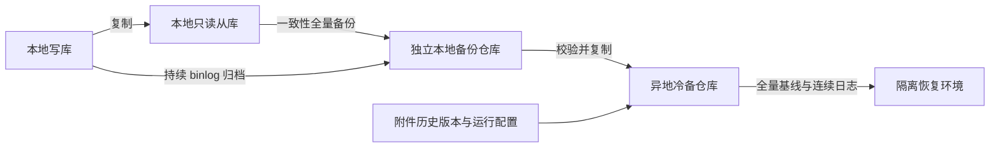

# MySQL 异地灾备方案设计与恢复演练

数据库灾备容易从“再申请一台服务器”开始，却在真正恢复时暴露缺口：备份下载太慢、日志缺段、附件没有同步，或者旧主重新上线后仍然接受写入。设计应先回答需要承受哪些故障、允许损失多少数据、多久恢复业务，再决定服务器与存储资源。

下面采用“本地主从＋独立备份仓库＋异地冷备＋隔离恢复环境”的通用架构。本地主从用于缩短部分实例故障的接管时间；整个生产机房不可用时，需要从异地备份重建运行环境。异地冷备没有持续运行的数据库实例，恢复时间必须包含资源就绪、备份还原和日志回放。

数据库机制以 MySQL 8.0、InnoDB 为范围；备份工具须按完整补丁版本、发行版和存储引擎选择。图示是逻辑设计，容量数字为完全模拟的预算示例，演练表描述验收方法。

## 一 先把故障范围与恢复路径对应起来

| 故障 | 主要恢复路径 | 必须保留的边界 |
| --- | --- | --- |
| 单个数据库实例或宿主故障 | 本地从库在确认进度与旧主隔离后接管 | 两个实例不能共用唯一宿主或故障存储 |
| 整个生产机房不可用 | 从异地冷备恢复数据库、附件及应用依赖 | 本地从库不能覆盖同机房整体故障 |
| 误删、错误更新、错误程序写入 | 隔离还原备份，恢复到错误事务之前，再评估修复范围 | 实时复制也会传播错误写入 |
| 备份被删除或凭证受损 | 使用独立权限和防删除保护的恢复副本 | 异地位置与独立管理权限需要同时考虑 |
| 数据库回退后外部操作不一致 | 核对已执行结果，按幂等身份补偿 | 恢复数据库不能撤销已经发生的外部操作 |

“主从复制正常”“备份任务成功”“业务能恢复”分别需要证据。复制保护当前数据副本，历史备份保留过去状态，恢复演练验证整条链是否可用。

## 二 用可测量的 RPO 与 RTO 约束设计

**恢复点目标 RPO（Recovery Point Objective）**表示可接受的数据损失时间范围。异地冷备应关注异地已持久化、与可用全量基线连续衔接的最后完整事务，而不是只看本地最近一次备份时间。

例如，归档进程仍在运行，但异地上传已经停止，机房故障时可恢复位置仍停留在上传中断之前。异地只收到一个新文件，也不代表它之前的日志全部齐备。低写入时可使用受控心跳或源端坐标核对，区分“没有新事务”与“采集已经停滞”。

**恢复时间目标 RTO（Recovery Time Objective）**表示故障发生后允许中断多久。数据库进程启动只是其中一段，应沿实际关键路径计算：

```text
业务恢复耗时
  = 检测与决策 + 资源及隔离准备 + 备份取回与还原
    + 日志回放 + 数据及附件核对 + 应用连接与功能验收
```

能并行的步骤按关键路径计时，避免重复累加。数据库 RTO 与核心业务 RTO 分别记录；恢复服务器临时申请、密钥不可取得或外部网络未开通，都会延长业务恢复时间。

目标应按故障类型分别确定。本地从库接管与异地冷备重建不能沿用同一个耗时承诺；异步复制与异步归档在断链期间也无法天然保证固定 RPO。

## 三 让每类资源承担明确职责



数据库实例、备份执行程序、备份仓库与恢复环境是不同资源。NAS 或对象存储提供保存能力，需要备份工具生成数据、调度程序执行任务、传输程序交付文件；仓库本身不会自动完成数据库备份。

| 内容 | 生成或管理程序 | 成功的判定 |
| --- | --- | --- |
| 物理全量 | 兼容的物理备份工具或企业备份平台 | 备份完整，能够完成准备与隔离还原 |
| 逻辑备份 | `mysqldump` 或对应平台 | 对象范围、字符集及导入过程经过核对 |
| binlog 归档 | `mysqlbinlog` 或备份平台采集组件 | 源端事务坐标到异地归档连续，无缺段 |
| 异地副本与过期清理 | 备份平台、Agent 或受控调度脚本 | 文件校验通过，保留与恢复依赖一致 |

备份执行节点可以复用已有平台，不必为每个角色新增一台常驻服务器；但 CPU、暂存空间、权限、网络和负责人都必须落实。应用服务不宜顺便承担数据库全量备份与仓库清理。

本地从库应具有独立故障资源，备份仓库还需隔离删除权限。至少一份恢复副本采用适合所选产品的不可变或防删除机制，并确认生产凭证受损时不能同时删除所有副本。加密密钥、证书及恢复账号也要能够在生产机房失效后取得。

## 四 前置条件应能转化为交付检查项

| 维度 | 需要确认的内容 | 交付证据 |
| --- | --- | --- |
| 版本与实例 | 完整版本、发行版、引擎、复制模式、实例身份 | 兼容矩阵与初始化记录 |
| 客户端配置 | 实际写入口、连接池、外部配置覆盖、域名缓存 | 所有写入客户端的切换清单 |
| 数据规模 | 数据与索引、实际备份大小、日志增长及峰值 | 带采样窗口的容量基线 |
| 网络与安全 | 连接发起方向、最小权限、TLS、密钥获取、带宽 | 按用途限制的连通性验证 |
| 运行依赖 | 附件、缓存、任务队列、检索索引及外部接口 | 可重建与必须持久化对象清单 |
| 决策权限 | 故障确认、旧主隔离、接管批准、夜间升级路径 | 明确人员和停止条件的操作手册 |

备份工具不能只按“安装最新版”选择。以 XtraBackup 为例，8.0 系列需核对具体服务器与工具的[支持版本](https://docs.percona.com/percona-xtrabackup/8.0/supported-versions.html)；8.4 系列官方明确不支持备份 MySQL 8.0，不能跨大版本直接套用。[XtraBackup 8.4 支持范围](https://docs.percona.com/percona-xtrabackup/8.4/)

## 五 让全量基线与日志组成连续恢复链

一次备份的生命周期应包含生成、校验、异地交付、隔离还原与过期清理。生成成功后，先写入完整性清单，再发布为可选恢复基线；未完成文件应有独立状态，不能被恢复任务误用。

清单至少记录备份身份、开始结束时间及时区、服务器与工具版本、已执行 GTID 或对应源端日志坐标、文件校验值和加密信息。从库备份需核对复制进度及源端坐标，不能把从库本地日志位置直接当成主库归档起点。

物理备份文件也不一定可以直接启动。XtraBackup 全量备份需要先完成 `prepare`，将复制期间不同时间取得的数据页整理到一致状态；准备步骤仍不能代替实际还原与业务检查。[物理备份准备过程](https://docs.percona.com/percona-xtrabackup/8.0/prepare-full-backup.html)

时间点恢复 PITR（Point-in-Time Recovery）需要全量备份及其后连续的必要 binlog。保留较早全量文件，却提前删除其后日志，不能继续声称支持这段时间内任意恢复点。[MySQL 时间点恢复](https://dev.mysql.com/doc/refman/8.0/en/point-in-time-recovery-binlog.html)

归档程序还应负责进程守护、断线续传、完整事务边界、缺段检测和异地落盘确认。`mysqlbinlog` 连接丢失后不会自动重连，需要外围管理补足；本地写出归档文件也不等于异地保存成功。[mysqlbinlog 备份限制](https://dev.mysql.com/doc/refman/8.0/en/mysqlbinlog-backup.html)

清理边界同时服从所有副本、变更数据捕获 CDC、归档交付和 PITR 需要，包含暂时离线的消费者。只有新恢复链已确认可用，旧链及其依赖才进入清理范围；失败演练所需证据和恢复材料应先保全。MySQL 的日志维护语句不会替运维判断所有离线消费者的需求。[MySQL 日志清理前提](https://dev.mysql.com/doc/refman/8.0/en/purge-binary-logs.html)

## 六 根据实际备份大小计算存储和带宽

主库卷的分配容量、库表统计容量、物理备份文件大小和压缩后上传量是四个不同指标。每日完整全量通常会重复保存未变化的数据，不能只按每日业务增量申请备份仓库。

```text
仓库基础占用
  = 实际单份全量大小 × 保留份数
    + 每日归档量 × 必要日志窗口
    + 逻辑备份及其他保留文件

申请容量
  = 仓库基础占用 + 在途文件 + 保留重叠 + 明确的安全余量
```

完全模拟一个例子：单份全量为 90 GiB，每天生成 8 GiB binlog，保留 21 份每日全量与至少 21 天日志，另保留 3 份各 50 GiB 的逻辑备份。基础占用为 `90 × 21 + 8 × 21 + 50 × 3 = 2208 GiB`；在合计量上另加 25% 预算，得到 `2760 GiB`，约 `2.70 TiB`。压缩或去重收益只有经过测量后才能扣减。

这份仓库预算不包含恢复环境的数据卷、解压与准备工作区，也不能代表生产日志盘预算。备份保留还可能因不可变期限、上传重试和新旧批次交叠而增加占用，应按具体平台测算。

带宽应同时满足首次全量、每日备份、持续日志及中断后的追赶。`文件大小 ÷ 有效传输速率`只能估算取回下限，后续解密、解压、准备、回放与 I/O 争用仍计入恢复时间。容量能存下与业务能及时恢复，需要分别验收。

## 七 用隔离与恢复门槛控制切换风险

本地从库接管前，先区分数据库故障、客户端故障和网络分区。连接不上旧主不能证明旧主已经停止写入，必须通过受控网络、电源或其他可靠手段隔离旧主及旧写入客户端。

`read_only`、`super_read_only`有助于防止从库被客户端误写，但并不代替故障隔离；复制线程等仍有特定允许行为，也需要防止控制面把只读配置重新改回。[MySQL 只读参数语义](https://dev.mysql.com/doc/refman/8.0/en/server-system-variables.html#sysvar_read_only)

异地冷备恢复可以按以下门槛推进：

1. **确认恢复范围。** 保全可用备份与日志，选择最后连续可恢复位置，记录可能损失区间；不能确认旧主隔离时，恢复实例保持隔离且不开放业务写入。
2. **在隔离环境还原。** 校验文件与密钥，准备物理备份，回放至确定的事务边界。误操作恢复应停在错误事务前，并评估之后正常变更的保留方式。
3. **核对跨系统数据。** 检查数据库引用的附件版本、任务状态和运行配置。数据库与对象存储的异步保护不具备天然的跨系统原子性，需要一致性检查点或缺失项补偿清单。
4. **建立唯一写入入口。** 确认接管授权，切换所有读写客户端并重建必要连接，先验证受控请求，再逐项恢复后台处理。
5. **核对外部副作用。** 数据库回退可能让已经发送的请求重新变成待处理；重派前按稳定幂等身份查询外部结果，不能批量重置所有处理中任务。
6. **重建保护能力。** 新主开始写入后立即恢复备份、日志归档与监控，并建立新的副本。后续回切从新主重建原环境、追平数据后按计划切换执行，不能只把地址改回旧库。

普通租约或执行令牌可以限制同一数据库时间线上的并发回写；数据库整体回退后，旧执行可能仍在外部运行，任务记录也可能回到旧状态。因此灾备恢复还需要独立的恢复轮次、旧执行隔离与外部结果对账。

## 八 把演练结果写成验收证据

| 演练场景 | 核心检查 | 应记录的证据 |
| --- | --- | --- |
| 完整全量还原 | 版本、准备、启动及数据范围正确 | 备份身份、校验值、各阶段耗时 |
| 指定事务位置恢复 | 日志连续，目标前后样例符合预期 | 基线坐标、停止边界、数据差异 |
| 归档中断与续传 | 能发现断链并识别缺口 | 最后安全位置、告警与补传记录 |
| 本地接管或机房级恢复 | 只有一个写入中心，全部客户端切换 | 隔离证据、连接目标、实际 RPO/RTO |
| 附件与任务恢复 | 引用可读取，外部操作不重复执行 | 模拟对象校验、幂等及补偿结果 |
| 回切 | 从新主重建原环境，切换后继续受保护 | 追平证据、新备份及归档连续性 |

演练环境使用完全模拟的数据，默认阻断真实通知、外部写入和生产任务消费。先完成隔离还原，再安排有明确故障范围与停止条件的切换演练。每次数据库版本、备份工具、数据规模或部署结构发生重要变化后，重新测量恢复关键路径。

日常监控至少检查最近可恢复基线、异地归档新鲜度与连续性、备份可用空间、复制错误及演练结果。恢复目标最终应由这些运行数据与演练证据支撑，而不是由服务器台数或一条备份成功状态推导。
