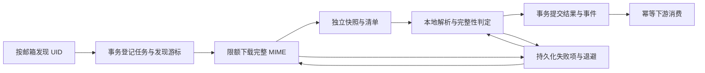

# IMAP 邮件可靠拉取与故障恢复方案

邮件元数据已经入库，正文或附件却没有完整保存；再次扫描时，又因为“这封邮件已存在”而被跳过。另一类故障是不断重试同一批旧邮件，新邮件始终排不到。仅增加超时或重连次数，无法修复这些处理状态与扫描边界问题。

可靠方案应先把三件事分开：发现了哪些远端邮件、哪些工作已经可靠登记、哪些内容真正处理完成。远端连接只负责取回内容，本地快照承接解析，持久化任务负责重试，数据库约束与事务负责控制重复结果。

以下给出目标架构与完全模拟的边界示例，验收表描述预期行为。协议部分采用 IMAP4rev1 与 rev2 的共有机制；Java 运行时说明参考 Jakarta Mail 与 Eclipse Angus 文档。旧 `javax.mail` 与新 `jakarta.mail` 不是可直接互换的包，Provider 扩展和参数仍需按实际发行版本核对。

## 一 先判断故障发生在哪个阶段

| 现象 | 优先检查 | 容易产生的后续问题 |
| --- | --- | --- |
| 连接失效后，读取主题或附件才报错 | 远端对象是否仍绑定有效会话 | 重连后继续使用旧对象，再次失败 |
| 读取异常被转换成空字符串或空列表 | 失败与合法空内容是否区分 | 不完整记录被标成功，去重阻断补偿 |
| 相同日期的历史件反复占据批次 | 是否先截批次，再去掉已处理项 | 新邮件饥饿，尝试数量被误当成功数量 |
| 单封失败后扫描位置仍向前推进 | 失败身份是否有独立持久化入口 | 后续扫描永远不再覆盖失败件 |
| 一个坏件持续失败，整个扫描停住 | 是否把发现与处理完成共用一个游标 | 新邮件与失败补偿互相阻塞 |
| 声明大小与下载长度不同 | 大小字段、分块实现和实际读取结果 | 将服务器兼容偏差一律误判为截断 |

`MessageRemovedException` 的 API 含义是对已经移除的消息执行无效操作；连接关闭、读取超时和协议异常应分别记录，不能都解释成“网络慢”。一段下载出现明确读超时，也不能反推此前所有元数据预取断线都由同一原因造成。[Jakarta Mail 消息移除异常](https://jakartaee.github.io/mail-api/docs/api/jakarta.mail/jakarta/mail/MessageRemovedException.html)

## 二 用本地任务承接远端发现结果



重试回到记录的失败阶段：下载失败重新取信，解析失败复用有效快照，提交结果不确定时先查询本地结果。图中的两条回路不表示每次都从下载开始。

| 持久对象 | 最少需要表达的信息 |
| --- | --- |
| 邮箱同步记录 | 来源账号、邮箱身份、UIDVALIDITY、已登记发现边界、发现者租约与轮次 |
| 邮件任务 | 稳定身份、当前阶段、尝试次数、下次执行时间、失败类别、租约与执行轮次 |
| 快照清单 | 不可变对象引用、实际字节数、摘要、下载方式、创建时间与校验状态 |
| 解析版本 | 快照身份、解析器版本、正文与附件处理结果、未决项、提交状态 |
| 可靠事件记录 | 结果身份、事件类型、投递状态和重试时间 |

核心约束是：发现游标越过某个已发现 UID 前，必须已经持久化对应任务；任务存在不等于内容完成；完成状态必须与结果提交一致。租约到期或重启之后，恢复者能够仅凭持久记录继续工作。

## 三 以 UID 命名空间识别远端邮件

消息顺序号会在其他邮件被 EXPUNGE 后改变，不能作为长期补拉键。持久身份可设计为：

```text
来源账号身份 + 邮箱身份 + UIDVALIDITY + UID
```

UID 只在对应邮箱与 UIDVALIDITY 内有意义，递增但不要求连续。UIDVALIDITY 改变时，建立新命名空间并对账，不能把旧游标直接带入。UID 与 UIDVALIDITY 的存储类型应覆盖协议无符号 32 位取值；应用与数据库之间避免有符号整数截断。[RFC 9051 邮件身份](https://www.rfc-editor.org/rfc/rfc9051.html#section-2.3.1.1)

来源账号身份应绑定实际来源；迁移服务商、重新绑定账号或重命名邮箱时，需要维护身份映射与迁移规则。唯一约束覆盖完整身份，相关列不允许缺失；不要用截断字符串前缀或不明确的拼接方式充当唯一性保证。

`Message-ID` 可用于关联，但不是 IMAP 投递实例的替代键。RFC 要求生成方保证其唯一并建议消息携带该头字段；现实中还要处理缺失、不合规及同一消息多次投递。内容摘要同样不能未经业务规则就合并不同投递。[RFC 5322 Message-ID](https://datatracker.ietf.org/doc/html/rfc5322#section-3.6.4)

## 四 将发现游标与处理完成彻底分离

### 使用有界 UID 窗口

不要直接把 `last_uid + 1:*` 当作纯增量范围。IMAP 范围不区分端点顺序，起点超过最大 UID 时，仍可能选中最后一封邮件；这种行为在 rev1 中就已明确。[RFC 3501 UID 范围](https://www.rfc-editor.org/rfc/rfc3501.html#section-6.4.8)

一种可实施的发现流程是：

1. 打开目标邮箱，确认当前 UIDVALIDITY 与有效 UIDNEXT，固定本轮上界 `H = UIDNEXT - 1`。
2. 从已登记边界的下一 UID 开始，按受控宽度选择闭区间 `[L, R]`，其中 `R <= H`；只有 `L <= R` 才查询。
3. 执行该区间的 `UID SEARCH`，确认查询完整结束。UID 有空洞是正常情况，不能按连续整数猜测存在邮件。
4. 在一个本地事务中幂等登记全部返回 UID，并推进发现边界至 `R`；提交时核对邮箱命名空间与发现者轮次。
5. 下载器独立消费任务。单封失败不阻止下一窗口发现，也不会因为发现边界前移而失去补偿入口。

UIDNEXT 是后续分配的边界，不保证该值对应已存在邮件。若服务端没有提供可靠 UIDNEXT，不能猜值；可受控降级为完整 UID 枚举与差异对账。缺少可靠 UIDVALIDITY 时，不再依赖旧持久 UID 映射，转入告警与兼容处理。[RFC 9051 UIDNEXT 语义](https://www.rfc-editor.org/rfc/rfc9051.html#section-2.3.1.1)、[RFC 3501 SELECT 响应约束](https://www.rfc-editor.org/rfc/rfc3501.html#section-6.3.1)

一个窗口若分多次写入，可先建立枚举清单与完成标记，最后再推进游标；不能只登记前一部分就声称整个窗口已发现。扫描任务本身也需要租约，避免两个实例互相覆盖边界。

### 防止旧邮件占满批次

日期条件只适合定义首次接入或历史回补范围。IMAP `SINCE` 使用服务器内部日期且按日比较，不能把它当分钟级收件游标，更不能混用发件人头部日期。[RFC 9051 SEARCH 日期条件](https://www.rfc-editor.org/rfc/rfc9051.html#section-6.4.4)

对于明确限定的历史时间窗，先登记符合范围的远端身份，再由本地状态筛选可处理任务。不要先截取同一天的前若干封，再去掉已完成项；否则每轮都可能回到相同旧件。首次同步是否覆盖全部历史应明确约定，不能用任意时间截断后仍声称全邮箱无遗漏。

## 五 在有效会话内生成可独立解析的快照

### 不把远端 Message 交给慢任务

远端消息可能在读取正文、附件或某些头字段时才请求服务器。Folder 关闭后，旧 Message 不再有效；重新打开 Folder 后也要按稳定 UID 重新获取对象。预取只能改变读取时机与缓存成本，不会生成持久快照。[Jakarta Mail Folder 生命周期](https://jakartaee.github.io/mail-api/docs/api/jakarta.mail/jakarta/mail/Folder.html)

应用层明确 Store、活动 Folder 和读取任务的所有权；线程之间传递稳定身份或本地快照引用，避免一个任务关闭另一个任务仍在读取的会话。解析、附件上传和下游调用移到快照阶段之后，缩短远端对象存活时间。

成功、失败或取消都应释放内容流与会话资源，清理异常不覆盖原始失败。快照与附件采用受控存储、明确授权和留存期限，连接使用 TLS 并验证服务端身份，凭据不进入配置示例或日志。

采集尽量使用只读打开和 `BODY.PEEK[]` 或对应 Provider 能力，避免下载顺便设置已读。释放 Folder 时显式选择 `close(false)`；无参关闭可能清除已标记删除的消息，不应将自动关闭直接当作无副作用清理。[BODY 与 PEEK](https://www.rfc-editor.org/rfc/rfc9051.html#section-6.4.5)、[Folder.close](https://jakartaee.github.io/mail-api/docs/api/jakarta.mail/jakarta/mail/Folder.html#close())

### 完整 MIME 流与普通正文流不同

快照应包含消息头和 MIME 结构。`MimeMessage.getRawInputStream()` 返回保留传输编码的正文内容，不能因为名称包含 Raw 就把它当成完整 EML。完整抓取应使用经过版本核验的整封消息接口或协议能力。[MimeMessage 原始内容流](https://jakartaee.github.io/mail-api/docs/api/jakarta.mail/jakarta/mail/internet/MimeMessage.html#getRawInputStream())

任意 `Message.writeTo()` 也不能统一承诺取证级原字节一致；对象是否加载、修改和序列化都会影响路径。快照清单要记录下载方式，摘要标识本地产物，不能单凭摘要证明它与服务器内部存储完全一致。[Angus 完整 MIME 流](https://eclipse-ee4j.github.io/angus-mail/docs/api/org.eclipse.angus.mail/org/eclipse/angus/mail/imap/IMAPMessage.html#getMimeStream())

### 完成检查不能只看声明大小

RFC822.SIZE 的协议定义是消息字节数，但服务器实现可能有兼容偏差。例如本地部署 Exchange 的官方配置允许返回估算大小；这不等于 IMAP 协议允许任意估算，也不能推广为所有云端服务的行为。[Microsoft 精确 RFC822 大小选项](https://learn.microsoft.com/en-us/powershell/module/exchangepowershell/set-casmailbox?view=exchange-ps#-imapenableexactrfc822size)

不能将声明大小与下载长度不等一律判为截断。应分别核对：目标 UID 确实返回内容、literal 与命令读取正常完成、实际字节未超过上限、快照可重读、MIME 结构和解析结果符合策略。不存在的 UID 可能得到成功结束但没有内容的 FETCH 响应，不能只检查 `OK`。[RFC 9051 UID 命令](https://www.rfc-editor.org/rfc/rfc9051.html#section-6.4.9)

先写临时对象，成功后发布不可变快照并保存实际长度与摘要。失败产物不进入可解析状态。完整读取和本地校验仍不能证明服务端从未丢失内容；真正需要端到端保真的场景，还要有来源侧保留、审计与对账依据。

## 六 按 MIME 结构判断正文与附件是否完整

解析器从本地快照读取，输出正文候选、附件清单、内联资源、异常与未决项，避免异常被转换成普通空结果。

- `multipart/alternative` 表达同一内容的不同呈现，应按策略选择并保留关系，不把纯文本与 HTML 简单拼成两份正文。
- `multipart/mixed` 可能同时包含正文和附件；`multipart/related` 需要区分主内容与关联资源，保留 Content-ID 引用关系。
- 嵌套邮件、字符集、传输编码及非标准文件名分别处理；仅凭文件名或 attachment disposition 判断附件会遗漏部分情况。
- 纯文本为空、HTML 有内容或仅附件邮件，都可能合法；“正文为空”必须结合结构、读取结果与接入规则判断。

这些分支应有明确的资源与容错策略，而不是在递归中遇错就返回空。文件名仅作为展示元数据，存储键由系统生成，避免覆盖、冲突和路径越界。[Angus MIME 与附件处理说明](https://eclipse-ee4j.github.io/angus-mail/FAQ.html#hasattach)

对快照大小、实际解码量、部件数、附件数、嵌套深度和解析时间分别设预算。流式下载接口不保证 Provider 没有先缓存完整内容，本地 MIME 解析也不天然恒定内存。关闭分块抓取可能绕开某些服务端问题，却增加内存压力，应按邮件大小与并发实测，而非作为所有邮箱的统一开关。[Angus IMAP 配置](https://eclipse-ee4j.github.io/angus-mail/docs/api/org.eclipse.angus.mail/org/eclipse/angus/mail/imap/package-summary.html)

## 七 用事务与幂等覆盖崩溃窗口

内容处理可采用以下阶段，状态名称只是设计示例：

```text
DISCOVERED → DOWNLOADING → SNAPSHOT_READY → PARSING → COMMITTING → COMPLETE

失败记录：failed_stage、attempt_count、next_retry_at、failure_code
特殊结果：SOURCE_UNAVAILABLE、MANUAL_REVIEW
```

完整快照已发布后，再以执行轮次条件更新任务引用。若对象先写入、数据库尚未提交就崩溃，会留下待核对孤儿对象；若引用存在而对象不可读，任务不能继续标成功。对象存储与数据库没有天然的同一本地事务，需要不可变引用、补偿记录和延后清理。

正文结果、附件引用、完成标识和可靠事件写入同一个本地事务。不要只在提交后立即调用通知或创建下游任务：进程可能在提交后、调用前退出。事务内事件记录负责可靠重试，消费端仍需幂等。

| 崩溃或不确定位置 | 恢复方式 |
| --- | --- |
| 发现事务提交前 | 重新扫描窗口，唯一约束阻止重复任务 |
| 下载中途 | 丢弃未完成临时产物，重新按 UID 获取 |
| 快照发布后、引用提交前 | 核对已有对象；孤儿清理等待引用与在途任务检查 |
| 解析完成后、结果提交前 | 复用同一快照与解析版本重试 |
| 提交响应丢失 | 按处理身份查询已提交结果，避免重复写入 |
| 结果提交后、事件投递前 | 恢复事件投递，消费者按事件身份去重 |

这是一套至少一次执行、幂等落库的设计，不是跨 IMAP、对象存储、数据库与外部系统的全局恰好一次承诺。解析器升级时建立新处理版本，保留旧结果，明确哪些下游效果允许重新发生。

## 八 用独立失败队列避免坏件阻塞新件

新邮件下载与失败补拉分配各自的连接和吞吐预算。失败队列按下次执行时间调度，使用带随机抖动的退避；达到连续失败或资源阈值后转人工处理并告警，保留身份和修复入口，不密集重试，也不静默删除。

下载器每次打开或重连邮箱，都先核对当前 UIDVALIDITY 与任务记录；一致时才按 UID 获取新对象。不一致时停止旧 UID 重试，转入新命名空间对账与原任务来源恢复处理，避免同数值 UID 指向另一封邮件。

确认源 UID 不存在或已永久删除后，记录来源不可用并检查保留副本；读取超时不能作为消息已删除的证据。鉴权、权限和配置错误暂停对应来源，避免重试风暴。解析缺陷复用快照，数据库故障回到提交阶段，不重复拉取整个邮箱。

领取任务时原子建立租约与执行轮次，续租和结果回写都检查当前所有权。租约过期不证明旧下载已经停止；新执行接管后，旧执行不能覆盖新状态。下面仅表达条件更新语义，参数由数据访问层绑定：

```sql
UPDATE mail_item
SET stage = 'SNAPSHOT_READY',
    snapshot_ref = :snapshot_ref,
    snapshot_digest = :snapshot_digest
WHERE id = :task_id
  AND stage = 'DOWNLOADING'
  AND execution_epoch = :execution_epoch
  AND lease_until > CURRENT_TIMESTAMP;
```

影响行数不是一行时，不继续推进；已经写出的对象进入受控核对。单封异常不能中止整个批次，其状态、实际成功数量和后续候选都需要独立管理。

## 九 分层设置超时与连接预算

以 Angus 的 IMAP 配置为例，连接、读取和写入超时是不同参数；`imaps` 对应 `mail.imaps.*`，不能配置了 `mail.imap.*` 就认定 TLS 连接已使用相同预算。[Angus 协议属性](https://eclipse-ee4j.github.io/angus-mail/docs/api/org.eclipse.angus.mail/org/eclipse/angus/mail/imap/package-summary.html)

| 约束 | 主要作用 |
| --- | --- |
| connectiontimeout、timeout、writetimeout | 分别限制连接、读、写操作，按实现使用毫秒 |
| 单次任务截止时间 | 限制多次网络往返组成的一次完整下载 |
| 邮箱连接数与并发字节预算 | 避免服务器限额、进程内存和磁盘互相争抢 |
| 批次大小与队列积压上限 | 在压力增长时降低发现或下载速度，保留持久任务 |

读取超时通常不是整封邮件的总耗时限制；拉长它可能减少误中断，也可能让坏件占用资源更久。先区分连接、元数据、内容下载、解析和提交阶段，再用受控大邮件测量预算。

IDLE 可以降低发现延迟，但需要服务端能力支持，断线后仍要补扫 UID；定期轮询与对账才是恢复入口。已读标志也不是消费确认，不能只拉 `UNSEEN`，否则其他客户端阅读邮件可能改变处理范围。[RFC 2177 IDLE](https://www.rfc-editor.org/rfc/rfc2177.html#section-3)、[RFC 9051 消息标志](https://www.rfc-editor.org/rfc/rfc9051.html#section-2.3.2)

## 十 先修复历史缺口再切换新流程

1. 核对数据库实际唯一约束、旧检查点含义、部分入库状态和失败记录。数据库“有一条邮件”不能直接迁移成完成。
2. 建立新任务记录和状态，优先复用可验证的本地快照；能确定远端身份的失败件按 UID 补拉，缺少身份的记录在限定范围重新枚举并人工核对。
3. 对曾经越过失败件的历史窗口做重叠扫描与对账，分别比较发现、快照、解析结果、附件及下游任务，而不是只比较总数。
4. 在模拟邮箱跑完整流程，再按来源逐步切换；影子验证关闭外部副作用，避免新旧流程同时创建下游结果。
5. 回退时保留新流程的任务与完成状态，不能回退到“记录存在就跳过”的旧判断。

远端邮件在独立快照生成前被永久删除，又没有归档或备份时，IMAP 无法凭空恢复正文与附件。需要与来源方约定保留时间、删除规则和恢复渠道；来源不可用与处理完成是两种不同结果。

## 十一 让监控和验收覆盖处理缺口

监控至少区分扫描尝试、发现 UID、新建任务、跳过完成项、快照成功、解析成功、最终提交、失败与来源不可用。完成率的分母必须明确，不能把本轮尝试数当新收件数。

同时观察最老未完成任务年龄、发现边界与处理进度、失败阶段、退避队列、连接重建、下载字节、临时盘与快照容量。扫描正常但旧任务长期不完成，也应告警。指标不携带邮箱地址、主题、正文或附件名；日志保留内部任务身份、阶段、轮次和错误类别即可。

以下场景使用隔离邮箱与完全模拟邮件验证，表内是验收标准：

| 模拟故障或边界 | 预期结果 |
| --- | --- |
| 断线发生在正文或附件读取中 | 旧对象不再复用，未完成快照不进入解析 |
| SEARCH 后邮件被移除，FETCH 无内容 | 识别来源不可用，不把命令成功当内容成功 |
| 空邮箱或没有新增 UID | 不执行反向范围，不重复占用最后一封 |
| UID 空洞、UIDVALIDITY 改变 | 不猜测丢信；新命名空间对账，不沿用旧游标 |
| 同日大量旧件夹杂新件 | 已处理项不反复耗尽下载批次，新件可以推进 |
| 一个坏件持续超时 | 有限额退避和人工入口，新邮件继续处理 |
| 下载大小与声明大小存在兼容偏差 | 按协议完成、实际字节与 MIME 策略判定，不只比较相等 |
| 纯文本、HTML、仅附件、内联及嵌套邮件 | 合法空内容与失败区分，正文及资源关系符合策略 |
| 大邮件、超多部件和并发下载 | 有明确限额，拒绝或隔离可见，不击穿资源预算 |
| 下载、发布快照、提交及投递之间退出 | 重启后按阶段恢复，没有无入口的未完成工作 |
| 两个执行者与迟到回写 | 唯一身份及执行轮次阻止重复结果与状态覆盖 |
| 解析器升级与历史不完整记录 | 可重放新版本，原有结果及外部效果按规则保留 |

上线门槛应是：未完成工作能被重新找到，坏件不会堵住新件，重试不会制造重复结果，来源删除与人工处理都可见。只有这些条件经过故障注入和对账验证，连接重试才成为完整恢复方案的一部分。
